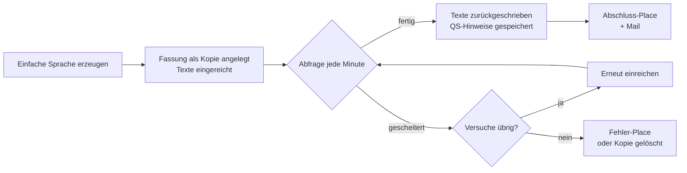

# Übersetzung & Einfache Sprache

🇬🇧 [English](../en/localization.md)

Lokalisierungs-Workflows erzeugen und prüfen die Fassungen eines Eintrags in anderen Sites – übersetzt mit DeepL oder von einem externen Dienst in Einfache Sprache umgeschrieben.

## Lokalisierungs-Workflows

Ein Workflow wird mit einem Key zum Lokalisierungs-Workflow:

```yaml
metadata:
  detail: translation
```

Sein Gegenstand ist dann nicht mehr der Eintrag als Ganzes, sondern **eine Site-Fassung im Verhältnis zu ihrer Quelle**. Das ändert, wie sich der Workflow verhält:

- **Er legt keine Einträge an.** Ein Lokalisierungs-Workflow hat keinen Button „Neuer Beitrag“. Das Anlegen gehört dem Autoren-Workflow, auch für Super-Admins.
- **Ihm gehört jede Lokalisierung, dem Autoren-Workflow die Quelle.** Das deutsche Original eines Beitrags läuft durch den Beitrags-Workflow, seine englische Fassung durch den Übersetzungs-Workflow. Jede Fassung hat pro Workflow eigenen Status, eigene Zuständige, eigenen Verlauf und eine eigene Detailseite.
- **Ihm gehört die Verteilung auf Sites.** Neue Fassungen entstehen über den Workflow, nicht von Hand. Der Entry-Editor blendet Statamics „Sites“-Karte aus. Super-Admins und Mitglieder von `privileged_groups` sind ausgenommen, damit sie eine kaputte Lokalisierung reparieren können.
- **Er beginnt, sobald der Beitrag veröffentlicht ist.** Solange die Ursprungsfassung in Statamic nicht veröffentlicht ist, hat der Beitrag in einem Lokalisierungs-Workflow keinen Status. Die Detailseite zeigt „Nicht gestartet“, und keine Transition führt heraus.
- **Er zeigt Quelle und Ziel nebeneinander.** Die Detailseite stellt die Quell-Fassung der Fassung in Prüfung gegenüber.

Das Addon bringt zwei Beispiele in `resources/workflows/examples/` mit: `translation.yaml` (DeepL mit sprachlicher und fachlicher Prüfung) und `plainlanguage.yaml` (Einfache Sprache mit fachlicher Prüfung). Kopiere sie nach `resources/workflows/`, um sie zu nutzen. Siehe [Workflows definieren](workflows.md).

### Übersetzungsmanager und Einfache-Sprache-Manager

Es gibt zwei Arten von Lokalisierungs-Workflows. Ein Key entscheidet, welche ein Workflow ist: `metadata.plain_language_site`.

| | Übersetzungsmanager | Einfache-Sprache-Manager |
| --- | --- | --- |
| Setzt `plain_language_site` | nein | ja, genau eine Site |
| Ziel-Site | im Sprach-Dialog gewählt | fest: die `plain_language_site` |
| Dienst | DeepL, synchron | Dienst für Einfache Sprache, asynchron |
| Abschnitt im Editor | „Übersetzung“ | „Einfache Sprache“ |
| Statuszeilen unter „Übersetzungs-APIs“ | `DEEPL_API_KEY` | `PLAIN_LANGUAGE_URL`, `PLAIN_LANGUAGE_TOKEN` |

Eine als `plain_language_site` beanspruchte Site ist für keinen anderen Lokalisierungs-Workflow mehr ein Ziel. Sie fällt aus dem Sprach-Dialog, aus dem Dialog „In andere Site überführen“ und aus deren serverseitigen Prüfungen.

Beide Manager können dieselbe Collection verwalten. Die mitgelieferten Beispiele verwalten beide `posts` und `pages`. Ein Beitrag hat dann pro Manager einen eigenen Status: die `plain`-Fassung gehört dem Einfache-Sprache-Manager, die `en`-Fassung dem Übersetzungsmanager.

> [!IMPORTANT]
> Place- und Transition-Handles müssen über alle Workflows eindeutig sein. Labels und Farben werden global per Handle aufgelöst, der erste Treffer gewinnt. Deshalb nutzt `plainlanguage.yaml` `plain_ready`, `in_plain_language` und eigene Transition-Handles.

## Site-Fassungen und Quelle

### Welche Fassung übersetzt wird

Jeder Manager übersetzt aus genau einer Quell-Fassung.

| Key | Typ | Standard | Beschreibung |
| --- | --- | --- | --- |
| `translation_source_site` | Site-Handle | Main-Site | Die Fassung, aus der übersetzt wird. Leer heißt Statamics Standard-Site; ein Beitrag ohne Fassung dort nimmt seinen Ursprung. Setze hier deine Einfache-Sprache-Site, um jede Übersetzung auf der Einfache-Sprache-Fassung aufzubauen. |
| `translation_source_pick` | bool | `false` | Der Sprach-Dialog fragt zusätzlich nach der Quelle, vorbelegt mit `translation_source_site` und begrenzt auf die Fassungen des Beitrags. Nur im Übersetzungsmanager, nicht im Einfache-Sprache-Manager. |

Fehlt einem Beitrag die Fassung in der eingestellten Quell-Site, bleibt die Start-Transition gesperrt und nennt den Grund. Der Manager fällt nie still auf eine andere Quelle zurück.

### Die Quelle muss fertig sein

Übersetzt wird nur aus abgeschlossener Arbeit. Die Quell-Fassung muss im **letzten Place** des Workflows stehen, der sie verwaltet:

| Quelle | Verwaltet von | Nötiger Status |
| --- | --- | --- |
| Main-Site | Beitrags-Workflow | der letzte Place, typischerweise `published` |
| Einfache-Sprache-Site | Einfache-Sprache-Manager | sein letzter Place, z. B. `plain_approved` |

Einige Details:

- Ein Beitrag mit unveröffentlichter Arbeitskopie (`pending_revision`) gilt als bereit. Die Live-Fassung ist veröffentlicht.
- Ein Beitrag in einer Alterungsstufe ist nicht bereit. Siehe [Inhaltsalterung (SLA)](sla.md).
- Verwaltet kein anderer Workflow die Quelle, prüft das Addon stattdessen das Veröffentlicht-Flag.
- Dieselbe Regel gilt für „Einfache Sprache neu erzeugen“.

Listen blenden Beiträge mit nicht fertiger Quelle nicht aus. Die Zeile bleibt, nur der Button ist mit Begründung gesperrt.

> [!NOTE]
> „Letzter Place“ meint die Reihenfolge der Places in der Definition, ohne reservierte Places wie `pending_revision` und Alterungsstufen. Hängst du einen Place an, der nach dem Abschluss kommt, wandert „fertig“ mit.

### Nur die Quell-Fassung startet eine Übersetzung

Auf jeder anderen Fassung ist die Start-Transition gesperrt: „Übersetzungen beginnen an der Quell-Fassung (…)“. Ebenso ist das Neu-Erzeugen von Einfacher Sprache an die Einfache-Sprache-Site gebunden.

### Site-Kürzel und Sprachcodes

Die Fassungen stehen auf der Detailseite unter „Übersetzungen“. Jede Fassung zeigt ihr Site-Handle in Großbuchstaben als Kürzel und dazu einen Sprachcode. Für den Sprachcode gruppiert das Addon Site-Handles nach Basis-Site:

- Ein Handle der Form `{base}_{lang}`, bei dem `{base}` selbst eine konfigurierte Site ist, nutzt das Suffix. `main` und `main_en` bilden eine Gruppe, und `main_en` zeigt `EN`.
- Jede andere Site nutzt die Kurzform ihrer eigenen Locale.

Das Kürzel nutzt bewusst das Handle, nicht die Locale. Eine Einfache-Sprache-Site teilt meist ihre Locale mit dem Original (`de_DE`), und das Kürzel muss beide trotzdem unterscheiden.

## Eine Lokalisierung starten

### Die Action `start_localization`

Eine Transition erzeugt die Ziel-Fassung. Du markierst sie mit der Action `start_localization`:

```yaml
transitions:
  start_translation:
    from: source_ready
    to: in_translation
    metadata:
      label: 'Start translation'
      required_group: translator
      actions:
        - type: start_localization
```

- Ein Lokalisierungs-Workflow braucht **genau eine** Transition mit dieser Action. Der Einstellungs-Editor speichert einen Workflow ohne sie oder mit zweien nicht.
- Außerhalb eines Workflows mit `detail: translation` wird die Action abgelehnt.
- Die Quelle bleibt in ihrem Place. Die neue Fassung entsteht in der Ziel-Site und bekommt die Transition.

Im Editor heißt die Action „Erzeugt die Ziel-Fassung (mit Sprachauswahl)“.

Was beim Klick passiert, hängt vom Manager ab:

- **Übersetzungsmanager:** Ein Dialog fragt „In welche Sprache übersetzen?“. Er bietet jede Site der Collection an, die noch keine Fassung hat, ohne beanspruchte Einfache-Sprache-Sites. Mit `translation_source_pick` fragt er auch nach der Quelle. Dann übersetzt DeepL, und die Fassung wird angelegt.
- **Einfache-Sprache-Manager:** kein Dialog. Die Fassung entsteht in `plain_language_site`, und die Texte gehen an den Dienst. Der Button ist gesperrt, solange eine Fassung existiert oder eine Umschreibung läuft.

Du kannst Prüfschritte vor den Start setzen. Die markierte Transition muss nicht aus dem Start-Place herausführen:

```yaml
transitions:
  review_source:
    from: plain_ready
    to: plain_reviewed
    metadata: { label: 'Source reviewed', required_group: editor }
  start_plain_language:
    from: plain_reviewed
    to: in_plain_language
    metadata:
      label: 'Create plain language'
      actions:
        - type: start_localization
```

> [!NOTE]
> Die Start-Transition erscheint nur dort, wo ihr `from` erreichbar ist. Prüfe das `from`-Feld, wenn du die Markierung verschiebst.

### Die Sperre `target_missing`

`target_missing` sperrt eine Transition, solange eine genannte Site schon eine Fassung des Beitrags hat. Sie funktioniert an jeder Transition, in jedem Workflow:

```yaml
transitions:
  review_source:
    from: plain_ready
    to: plain_reviewed
    metadata:
      label: 'Source reviewed'
      actions:
        - type: target_missing
          site: plain
```

- Die Sperre sperrt nur, sie gewährt nie etwas. Zuständigkeit, Gruppe und alle anderen Prüfungen gelten weiter.
- Ein gesperrter Button zeigt „Es gibt bereits eine Version in ….“
- Eine Transition kann mehrere Sperren tragen, und eine Sperre kann neben einem Dialog stehen.
- Die Site muss eine konfigurierte Site sein, sonst speichert der Editor nicht.

Im Editor heißt die Action „Sperre: Site muss noch fehlen“.

### Wer die neue Fassung bekommt

Nur Zuständige können eine Transition ausführen. Gib der neuen Fassung jemanden, der daran arbeitet:

| Key | Beschreibung |
| --- | --- |
| `assign_creator: true` | Wer die Lokalisierung gestartet hat, wird der neuen Fassung zugewiesen. |
| `default_assignee_group` | Mitglieder dieser Gruppe werden zugewiesen, wenn eine Fassung entsteht. |

Die Zuweisung des Erstellers endet mit der ersten Transition.

## Der Übersetzungsmanager

Mit `metadata.nav` bekommt jeder Lokalisierungs-Workflow eine eigene Manager-Seite unter `/cp/workflows/<slug>`. Die mitgelieferten Beispiele nutzen die Slugs `translation-manager` und `plain-language-manager`.

Die Manager-Seite zeigt:

- **„Übersetzbare Beiträge“:** Beiträge, deren Quell-Fassung existiert und fertig ist. Die Spalten zeigen zuerst die Quell-Site, dann die Ziel-Sites, jeweils mit dem Status der Fassung.
- **„Mir zugewiesen“** und **„Meine Beiträge“**. Sie zeigen nur Fassungen in Sites, die dieser Manager liest oder schreibt.

Eine Zeile öffnet die Quell-Fassung. Die Fassungsliste auf der Detailseite bleibt im aktuellen Manager, solange er für die Fassung zuständig ist.

### Die Quelle auf der Detailseite ausblenden

`translation_source_view` steuert, wer die Quellspalte der Detailseite sieht:

```yaml
metadata:
  translation_source_view:
    - mode: collapsed
      by: group
      handles: [linguistic_reviewer]
    - mode: hidden
      by: role
      handles: [external_translator]
```

| Modus | Label im Editor | Wirkung |
| --- | --- | --- |
| `hidden` | „Nur Übersetzung“ | Die Quelle wird gar nicht an den Browser geliefert. |
| `collapsed` | „Quelle eingeklappt“ | Die Seite öffnet einspaltig. Ein Button blendet die Quelle ein. |

`by` ist `group`, `role` oder `user`; `handles` nennt Gruppen- oder Rollen-Handles bzw. Benutzer-IDs. Wen keine Regel trifft, sieht beide Spalten. Treffen mehrere Regeln, gilt die strengere. Das ist eine Darstellungsregel, keine Berechtigung: Sie gilt auch für Super-Admins.

Du pflegst die Regeln in den Workflow-Einstellungen unter „Quellansicht je Zielgruppe“. Siehe [Workflow-Editor](editor.md).

## Maschinelle Übersetzung mit DeepL

Der Übersetzungsmanager nutzt DeepL. Setze `DEEPL_API_KEY` in deiner `.env`; die Einrichtung beschreibt [Übersetzung & Einfache Sprache (Erweitern)](extending/translation.md).

### Was beim Start passiert

1. Das Addon liest alle übersetzbaren Texte der Quell-Fassung aus.
2. DeepL übersetzt die Texte. Der ganze Lauf ist auf 45 Sekunden begrenzt.
3. Erst wenn alles übersetzt ist, wird die neue Fassung angelegt und die Transition angewendet.

Scheitert DeepL, wird nichts angelegt. Die Redaktion sieht eine Meldung wie „Der DeepL-API-Schlüssel wurde abgelehnt.“ oder „Das DeepL-Kontingent ist aufgebraucht.“ Ohne API-Schlüssel entsteht die Fassung als 1:1-Kopie der Quelle.

### Was übersetzt wird

Das Blueprint entscheidet. Das Addon durchläuft alle Felder des Eintrags und übersetzt:

- Felder vom Typ `text`, `textarea` und `markdown`,
- Bard-Felder samt Text in ihren Sets,
- Text in Replicator-Zeilen, Grid-Zeilen und Groups,
- die Prosa-Unterschlüssel eines SEO-Pro-Feldes (siehe [SEO-Behandlung](#seo-behandlung)).

Nie übersetzt werden `slug`, `date`, `published` und die Top-Level-Felder aus `metadata.translation_exclude_fields`:

```yaml
metadata:
  translation_exclude_fields: [author_note, internal_id]
```

`translation_exclude_fields` hat kein Feld im Editor. Setze es in der YAML; der Editor behält es beim Speichern.

> [!WARNING]
> Markiere übersetzte Felder im Blueprint als `localizable: true`. Sonst wird die Übersetzung zwar geschrieben, das Publish-Formular zeigt aber den Wert des Ursprungs, und das nächste Speichern kann sie überschreiben. Das Addon warnt beim Übersetzen vor solchen Feldern.

### Sprachcodes

DeepL bekommt die Quelle als reine Sprache (`DE`) und das Ziel als regionale Variante, wo es eine gibt – abgeleitet aus der Locale der Ziel-Site: `en_GB` wird `EN-GB`, `en` und `en_US` werden `EN-US`, `pt_BR` wird `PT-BR`.

## Einfache Sprache

Der Einfache-Sprache-Manager schickt Texte an einen externen Umschreibe-Dienst. Der Dienst arbeitet asynchron: Ein geplanter Befehl holt die Ergebnisse ab. Zugangsdaten, Scheduler und Grenzen beschreibt [Übersetzung & Einfache Sprache (Erweitern)](extending/translation.md).

### Ablauf



1. **Einreichen.** Die Start-Transition legt die Fassung als Kopie der Quelle an und reicht den Inhalt ein. Die Detailseite zeigt „Wird gerade in Einfache Sprache umgeschrieben …“, wenn der Place die Spinner-Action trägt. Lehnt der Dienst die Einreichung sofort ab, wird die Kopie gelöscht und ein Fehler erscheint.
2. **Abfragen.** `workflows:plain-language-poll` läuft über den Scheduler jede Minute und fragt den Dienst nach Ergebnissen.
3. **Zurückschreiben.** Eine fertige Umschreibung wird Block für Block in die Fassung geschrieben. Titel, Inhaltsfelder und SEO-Texte werden aktualisiert.
4. **Wiederholen.** Eine gescheiterte oder zu lange laufende Einreichung wird erneut geschickt, bis zu `max_attempts` Einreichungen. Die Detailseite zeigt „Versuch n von m“.
5. **Abschließen.** Bei Erfolg kann die Fassung automatisch weiterwandern. Nach dem letzten gescheiterten Versuch wandert sie in den Fehler-Place, oder die Kopie wird gelöscht.

> [!WARNING]
> Ohne den Laravel-Scheduler (oder einen eigenen Runner für `workflows:plain-language-poll`) wird eine eingereichte Umschreibung nie zurückgeschrieben. Siehe [Befehle & Scheduler](commands.md).

### Was gesendet wird

Der Dienst bekommt die **Inhaltsfelder** des Workflows: `metadata.content_fields`, oder die automatisch erkannten Felder, wenn keine gesetzt sind. Jeder Prosa-Block geht als eigener Abschnitt hinaus und kommt an genau dieselbe Stelle zurück. Felder aus `translation_exclude_fields` und das Feld `seo` werden nie gesendet. Siehe [Inhaltsfelder](extending/content-fields.md).

### Einstellungen

Alle Keys stehen unter `metadata` und setzen `plain_language_site` voraus.

| Key | Label im Editor | Beschreibung |
| --- | --- | --- |
| `plain_language_site` | „Ziel-Site“ | Die eine Site, in die dieser Manager schreibt. Macht den Workflow zum Einfache-Sprache-Manager. |
| `plain_language_completed_place` | „Ziel-Place nach Job-Abschluss“ | Wohin eine Fassung wandert, sobald ihre Umschreibung erfolgreich zurückgeschrieben ist. Ohne diesen Key bleibt sie stehen, bis jemand die nächste Transition klickt. |
| `plain_language_failed_place` | „Ziel-Place bei fehlgeschlagener Übersetzung“ | Wohin eine Fassung wandert, wenn die Umschreibung endgültig gescheitert ist. Ohne diesen Key wird die unberührte Kopie gelöscht. |
| `plain_language_skip_fields` | „Nicht umschreiben“ | Textfelder, die nie gesendet werden und ihren Wert behalten: `field`, `set.field` oder `*.field`. Für Anker-IDs, Embed-Codes, Button-Labels. |
| `plain_language_clear_fields` | – | Top-Level-Felder, die nach einer Umschreibung auf der Einfache-Sprache-Fassung geleert werden, etwa eine Quellenliste. Nur in der YAML. |

Beide Place-Wechsel umgehen Transitions: keine Gruppenprüfung, kein Zuständigen-Wechsel, keine Veröffentlichungs-Sperre. Mails am Ziel-Place gehen trotzdem raus.

> [!TIP]
> Setze `plain_language_completed_place`. Nur so bekommst du eine Mail „Einfache Sprache ist fertig“: Gib diesem Place eine `mail`-Action mit `mail_type: plain_language_ready`. Ohne Statuswechsel kann niemand benachrichtigt werden. Siehe [Benachrichtigungen](notifications.md).

`plain_language_clear_fields` schreibt einen ausdrücklich leeren Wert, statt das Feld zu entfernen. Ein entfernter Wert fiele auf den Text des Ursprungs zurück. Titel und Inhaltsfelder lassen sich nie leeren.

### Place-Actions für die Wartezeit

Zwei Place-Actions helfen, solange eine Umschreibung läuft. Beide setzen `plain_language_site` voraus.

```yaml
places:
  in_plain_language:
    metadata:
      actions:
        - type: pending_rewrite_spinner
        - type: refresh_interval
          minutes: 10
```

| Typ | Label im Editor | Wirkung |
| --- | --- | --- |
| `pending_rewrite_spinner` | „Ladeanzeige während Umschreibung“ | Ersetzt den Inhalt durch eine Ladeanzeige, solange ein Auftrag offen ist. |
| `refresh_interval` | „Aktualisieren nach X Minuten (mit Modal)“ | Fragt nach den angegebenen Minuten (1–1440), ob neu geladen werden soll – sobald die Umschreibung angekommen ist. |

### Fehlschlag und Wiederholung

Eine Einreichung gilt als gescheitert, wenn der Dienst einen Fehler meldet, den Auftrag nicht mehr kennt, unbrauchbare Ausgabe liefert, mit Abschnitten antwortet, die nicht zum Gesendeten passen, oder nach `max_polls` Abfragen nicht fertig ist. Jeder gescheiterte Versuch steht im Verlauf („Versuch n von m fehlgeschlagen: … Erneut an den Dienst geschickt.“).

Nach dem letzten Versuch:

- **Mit `plain_language_failed_place`:** Die Fassung wandert dorthin und bleibt. Sie ist in der Queue und im Dashboard sichtbar.
- **Ohne:** Die unberührte Kopie wird gelöscht. Es bleibt nur eine kurze Meldung.

Eine Fassung, die schon eine Umschreibung trug, wird nie gelöscht.

Verbindungsfehler (DNS, TLS, Timeout) zählen nicht als Versuch. Der nächste Lauf versucht es erneut.

### Neu umschreiben: `plain_language_resubmit`

Eine Transition mit der Action `plain_language_resubmit` legt nichts an. Sie schickt den Quelltext erneut an den Dienst und überschreibt die bestehende Einfache-Sprache-Fassung mit dem Ergebnis.

```yaml
transitions:
  regenerate_plain_language:
    from: [plain_ready, in_plain_language, plain_generated, plain_review, plain_approved]
    to: in_plain_language
    metadata:
      label: 'Rewrite plain language'
      required_group: editor
      actions:
        - type: plain_language_resubmit
```

- Nur im Einfache-Sprache-Manager erlaubt. Mehrere Transitions dürfen sie tragen.
- Gesperrt, solange noch eine Umschreibung läuft, und solange keine Einfache-Sprache-Fassung existiert.
- Nimm den Start-Place in `from` auf: Die Quell-Fassung steht immer dort.
- Nimm deinen `plain_language_failed_place` in `from` auf, dann ist ein zweiter Versuch ein Klick.

Im Editor heißt die Action „Einfache Sprache neu erzeugen“.

Das Statistik-Widget im Dashboard zeigt eine Karte „Fehlgeschlagene Übersetzungen“ mit dem Link „erneut starten“. Er führt die Transition aus dem Fehler-Place für jede geparkte Fassung aus, die du bewegen darfst. Siehe [Dashboard-Widgets](extending/dashboard-widgets.md).

### Hinweise zur KI-Überarbeitung

Der Dienst kann einen Prüfbericht liefern: was er vereinfacht, ergänzt und weggelassen hat. Das Addon speichert ihn am Beitrag und zeigt ihn auf der Detailseite hinter dem Button **„Hinweise zur KI-Überarbeitung“**. Im Kommentar-Thread erscheint der Bericht nicht.

Erreicht die Fassung den `plain_language_completed_place`, wird der Button hervorgehoben: „Neuer Prüfbericht — bitte vor der Freigabe lesen.“

Wer den Button sieht, steuerst du im Einfache-Sprache-Workflow:

```yaml
metadata:
  qs_notes_visible: true
  qs_notes_audience:
    - by: group
      handles: [medical_writer]
```

| `qs_notes_visible` | `qs_notes_audience` | Wer die Hinweise sieht |
| --- | --- | --- |
| `false` | – | niemand |
| `true` (Standard) | leer | alle |
| `true` | Zeilen | Super-Admins und wer auf eine Zeile passt |

Jede Zeile hat `by` (`group`, `role` oder `user`) und `handles`. Im Editor heißen die Einstellungen „QS-Hinweise anzeigen“ und „QS-Hinweise anzeigen für:“ im Abschnitt „Einfache Sprache“.

> [!NOTE]
> Der Bericht wird nur bei einer erfolgreichen Umschreibung übernommen, und nur, wenn der Dienst ihn als Text liefert.

## SEO-Behandlung

**Übersetzung (DeepL).** Diese Unterschlüssel eines SEO-Pro-Feldes werden übersetzt: `title`, `description`, `og_title`, `twitter_title`, `twitter_description`. Alle anderen (Bilder, Robots, URLs, Handles) behalten ihren Wert.

**Einfache Sprache.** `seo` wird nie an den Dienst geschickt. Stattdessen leitet das Addon zwei Werte aus der Umschreibung ab:

- `seo.title`: der umgeschriebene Titel.
- `seo.description`: der erste Absatz der umgeschriebenen Einleitung oder des ersten Rich-Text-Blocks. An einer Wortgrenze auf höchstens 160 Zeichen gekürzt.

Der Rest des SEO-Arrays bleibt erhalten. Ein erneutes Umschreiben leitet beide Werte neu ab und überschreibt Handkorrekturen.

Auf beiden Wegen bleiben zwei Werte immer unangetastet:

- `seo: false` (SEO Pro für den Eintrag abgeschaltet),
- `@seo:<handle>`-Verweise auf ein anderes Feld.

> [!WARNING]
> Übersetzungen und abgeleitete Titel werden nicht gekürzt. SEO Pro empfiehlt 60 Zeichen für den Titel und 160 für die Beschreibung. Das Publish-Formular zeigt die Warnung beim nächsten Speichern.

## Einfache-Sprache-Fassungen nachträglich bereinigen

Fassungen, die umgeschrieben wurden, bevor es die SEO-Ableitung oder `plain_language_clear_fields` gab, tragen noch die Meta-Texte und zu leerenden Felder des Originals. Der Backfill-Befehl wendet beide Regeln auf sie an:

```bash
# Vorschau: vorher → nachher je Unterschlüssel und Feld
php artisan workflows:backfill-plain-language --dry-run

# Nur ein Einfache-Sprache-Workflow
php artisan workflows:backfill-plain-language --workflow=plainlanguage

# Auch Werte überschreiben, die nach der Umschreibung bearbeitet wurden
php artisan workflows:backfill-plain-language --force
```

| Option | Beschreibung |
| --- | --- |
| `--workflow=` | Nur dieser Einfache-Sprache-Workflow. Standard: alle Workflows mit `plain_language_site`. |
| `--force` | Werte überschreiben, die nach der Umschreibung bearbeitet wurden. |
| `--dry-run` | Zeigt, was geschrieben würde, ändert nichts. |

Was er pro Fassung in der Einfache-Sprache-Site tut:

1. Er leitet `seo.title` und `seo.description` aus dem eigenen Inhalt der Fassung ab.
2. Er leert die Felder aus `plain_language_clear_fields`.

Übersprungen werden Fassungen mit noch laufender Umschreibung und Fassungen, die nie umgeschrieben wurden. `seo: false` überspringt nur den SEO-Teil. Werte, die jemand nach der Umschreibung bearbeitet hat, bleiben stehen und werden als `edited` gemeldet, außer du gibst `--force` an.

Der Befehl schreibt keine Verlaufs-Events und ist idempotent: Ein zweiter Lauf meldet alles als `unchanged`.

## Referenz: Lokalisierungs-Keys

Alle Keys stehen unter `metadata` eines Lokalisierungs-Workflows.

| Key | Typ | Beschreibung |
| --- | --- | --- |
| `detail` | `translation` | Macht den Workflow zum Lokalisierungs-Workflow. |
| `plain_language_site` | Site-Handle | Macht ihn zum Einfache-Sprache-Manager mit dieser Ziel-Site. |
| `translation_source_site` | Site-Handle | Quell-Fassung. Standard: Main-Site. |
| `translation_source_pick` | bool | Im Sprach-Dialog nach der Quelle fragen. Nur Übersetzungsmanager. |
| `translation_source_view` | Liste | Wer die Quellspalte wie sieht. |
| `translation_exclude_fields` | Liste | Top-Level-Felder, die nie übersetzt oder umgeschrieben werden. |
| `plain_language_completed_place` | Place | Wohin eine fertige Umschreibung die Fassung setzt. |
| `plain_language_failed_place` | Place | Wohin eine gescheiterte Umschreibung die Fassung setzt. |
| `plain_language_skip_fields` | Liste | Textfelder, die nie an den Dienst gehen. |
| `plain_language_clear_fields` | Liste | Felder, die nach einer Umschreibung geleert werden. |
| `qs_notes_visible` | bool | QS-Hinweise anzeigen. Standard `true`. |
| `qs_notes_audience` | Liste | Wer die QS-Hinweise sieht. |
| `source_draft_place` | Place | Wohin diese Fassung zurückfällt, wenn der Beitrag auf Entwurf geht. Siehe [Inhaltsalterung (SLA)](sla.md). |
| `seed_published_place` | Place | Status für bereits lokalisierte Beiträge beim Nachtragen der Status. Siehe [Befehle & Scheduler](commands.md). |

Transition-Actions: `start_localization`, `target_missing` (mit `site`), `plain_language_resubmit`. Place-Actions: `pending_rewrite_spinner`, `refresh_interval` (mit `minutes`).

## Nächste Schritte

- [Übersetzung & Einfache Sprache (Erweitern)](extending/translation.md): Zugangsdaten, Scheduler und Grenzen der Dienste
- [Inhaltsfelder](extending/content-fields.md): welche Felder als Inhalt zählen
- [Inhaltsalterung (SLA)](sla.md): was mit Fassungen passiert, wenn die Quelle altert
- [Befehle & Scheduler](commands.md): Poll- und Backfill-Befehl

---

← [Benachrichtigungen](notifications.md) · [Doku-Start](README.md) · [Inhaltsalterung (SLA)](sla.md) →
