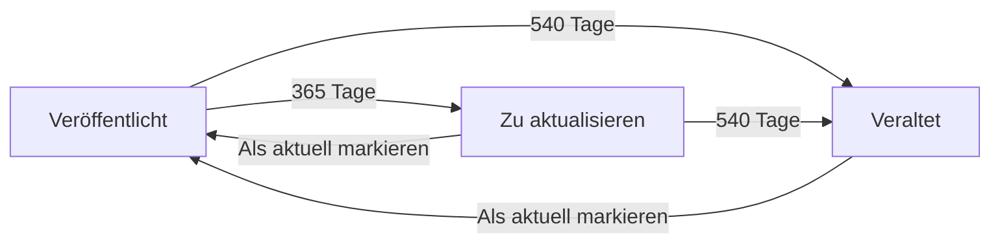

# Inhaltsalterung (SLA)

🇬🇧 [English](../en/sla.md)

Verschiebe veröffentlichte Einträge in eigene Prüfschritte, wenn sie zu lange nicht aktualisiert wurden, und nimm ihre Übersetzungen bei Bedarf mit offline.

## Überblick

Die Inhaltsalterung hat drei Teile. Jeder lässt sich einzeln nutzen.

| Teil | Was er tut | Wo du ihn einstellst |
| --- | --- | --- |
| Die Uhr | `content_updated_at` an jeder Fassung eines Eintrags: das Datum, an dem ihr Inhalt zuletzt freigegeben wurde. | Wird automatisch gesetzt |
| Die Stufen | Nach X Tagen wandert der Eintrag in einen Place deiner Wahl. Bis zu zwei Stufen. | `metadata.sla` im Autoren-Workflow |
| Die Kaskade | Geht der Eintrag offline, folgen seine Übersetzungen in einen Place ihrer Wahl. | `metadata.source_draft_place` in jedem Lokalisierungs-Workflow |

Übersetzungen, die nicht verschoben werden, zeigen trotzdem die Markierung „veraltet“, sobald ihre Quelle erneut freigegeben wurde (siehe [Das abgeleitete „veraltet“](#das-abgeleitete-veraltet)).



## Die Uhr

Jeder Eintrag in einer Collection eines Autoren-Workflows bekommt das Datumsfeld `content_updated_at` mit der Beschriftung „Inhaltlich aktualisiert“. Du fügst es nicht selbst ins Blueprint ein; das macht das Addon. Jede Sprachfassung trägt ihren eigenen Wert.

Die Uhr wird auf heute gestellt, wenn eine Fassung:

- über eine Transition in einem Place mit `allow_publish` ankommt, etwa bei „Veröffentlichen“ oder „Als aktuell markieren“, oder
- ihre Arbeitskopie veröffentlicht wird (mit Statamic-Revisionen).

Die Ankunft im Status „Unveröffentlichte Änderungen“ stellt sie nicht. Ein gewöhnliches Speichern auch nicht, ein Tippfehler-Fix verlängert also keine Frist.

Eine Fassung, die noch nie gestempelt wurde, fällt auf ihr Veröffentlichungsdatum (`date`) zurück und, wenn es keines gibt, auf das Änderungsdatum der Datei.

### Wer sie ändern darf

Alle sehen das Feld im Eintrags-Editor. Bearbeiten können es nur Super-Admins; für alle anderen ist es schreibgeschützt, und das Addon behält beim Speichern durch andere zusätzlich den alten Wert. Die Spalte „Inhaltlich aktualisiert“ in den Manager-Seiten zeigt denselben Wert und lässt sich danach sortieren.

Standardmäßig landet das Feld im ersten Tab des Blueprints. Um es woanders zu platzieren, trägst du das Handle nur mit seinem Typ in dein Blueprint ein:

```yaml
-
  handle: content_updated_at
  field:
    type: date
```

Alles Weitere ergänzt das Addon. Setze `visibility` nicht in der YAML: der Wert gälte dann für alle und hebelte die Super-Admin-Regel aus.

### Bestandsinhalte nachtragen

Um bestehenden Inhalten einen eigenen gespeicherten Wert zu geben, führst du einmalig aus:

```bash
php artisan workflows:backfill-content-timestamp --dry-run
php artisan workflows:backfill-content-timestamp
```

| Option | Beschreibung |
| --- | --- |
| `--workflow=` | Nur die Collections dieses Workflows. Standard: alle Autoren-Workflows. |
| `--force` | Überschreibt auch Fassungen, die schon einen Wert haben. |
| `--dry-run` | Zeigt, was geschrieben würde, ändert nichts. |

Der Befehl schreibt denselben Wert, den der Rückfall liefern würde, Fristen ändern sich also nicht. Du brauchst ihn für den Vergleich je Fassung hinter der Markierung „veraltet“.

## Die Stufen einrichten

Die Stufen sind gewöhnliche Places deines Workflows, mit eigenem Handle, Label, eigener Farbe und eigenem `allow_publish`. `metadata.sla` sagt nur, wann der Eintrag in welchen davon wandert.

```yaml
metadata:
  sla:
    needs_update_days: 365
    needs_update_place: needs_update
    outdated_days: 540
    outdated_place: outdated

places:
  published:
    label: 'Veröffentlicht'
    metadata: { allow_publish: true }
  needs_update:
    label: 'Zu aktualisieren'
    metadata: { allow_publish: true, color: amber, branch: true }
  outdated:
    label: 'Veraltet'
    metadata: { color: red, branch: true }

transitions:
  mark_up_to_date:
    from: [needs_update, outdated]
    to: published
    metadata: { label: 'Als aktuell markieren' }
```

| Schlüssel | Typ | Standard | Beschreibung |
| --- | --- | --- | --- |
| `needs_update_days` | `int` | – | Alter in Tagen für die erste Stufe. `0` heißt: beim nächsten Scheduler-Lauf. |
| `needs_update_place` | `string` | – | Place-Handle der ersten Stufe. |
| `needs_update_assign` | `object` | – | Optional. Wer bei der Ankunft zuständig wird: `{by: group\|role\|user, handles: [...]}`. |
| `outdated_days` | `int` | – | Alter in Tagen für die zweite Stufe. Mindestens `needs_update_days`. |
| `outdated_place` | `string` | – | Place-Handle der zweiten Stufe. |
| `outdated_assign` | `object` | – | Optional. Wie `needs_update_assign`, für die zweite Stufe. |

Beide Stufen sind optional, Tage und Place wirken aber nur gemeinsam. Eine Stufe mit nur einem von beiden wird beim Speichern abgelehnt. Im [Workflow-Editor](editor.md) stellst du das alles im Tab „SLA“ ein: „Erste Stufe nach X Tagen“, „Erste Stufe: Schritt“, „Erste Stufe: zuständig“ und dasselbe für die zweite Stufe.

```yaml
metadata:
  sla:
    needs_update_days: 365
    needs_update_place: needs_update
    needs_update_assign:
      by: group
      handles: [editor]
```

Beim Speichern prüft das Addon, dass:

- `sla` in einem Autoren-Workflow steht, nicht in einem Lokalisierungs-Workflow,
- der Place jeder Stufe in diesem Workflow existiert,
- die Tage leer oder eine ganze Zahl ab `0` sind,
- die zweite Stufe nicht vor der ersten liegt.

### So gestaltest du die Stufen

- **`allow_publish` entscheidet, ob der Eintrag online bleibt.** Ein Stufen-Place ohne `allow_publish` nimmt den Eintrag bei der Ankunft offline, und mit ihm jede Übersetzung, die einen `source_draft_place` hat. Ist die erste Stufe nur als Hinweis gedacht („fällig zur Aktualisierung, aber weiter online“), gib ihr `allow_publish: true`.
- **Den Weg zurück bestimmst du.** Lege eine Transition von den Stufen-Places zurück in deinen Veröffentlichungs-Place an, etwa „Als aktuell markieren“. Die Ankunft im Veröffentlichungs-Place stellt die Uhr neu. Nenne beide Stufen-Places in ihrem `from`, sonst bleibt ein veralteter Eintrag hängen.
- **Der Weg hinein ist optional.** Eine Transition in einen Stufen-Place brauchst du nicht; der Scheduler verschiebt den Eintrag auch so. Lege eine an, wenn die Verschiebung Actions ausführen soll, etwa den Eintrag per `user_assignment` jemandem übergeben oder eine `mail` verschicken.
- **Stufen-Places liegen neben der Hauptlinie.** Das Addon lässt sie aus der Hauptlinie der Fortschrittsleiste heraus und behandelt sie nicht als letzten Schritt des Workflows. `branch: true` zeichnet sie im Editor und in der Fortschrittsleiste als Abzweig.
- **Benachrichtige mit dem Mail-Typ `sla`.** Hänge eine `mail`-Action mit `mail_type: sla` an den Stufen-Place oder an die Transition dorthin. Die Mail sagt, dass der Beitrag seit seiner letzten Freigabe nicht aktualisiert wurde, und bittet um Prüfung. Siehe [Benachrichtigungen](notifications.md#mail-typen).

## Der stündliche Task

`php artisan workflows:transition-aged` verschiebt gealterte Einträge. Das Addon meldet ihn stündlich beim Laravel-Scheduler an.

| Schlüssel | Env | Standard | Beschreibung |
| --- | --- | --- | --- |
| `sla_scheduler` | `WORKFLOWS_SLA_SCHEDULER` | `true` | Meldet den stündlichen Task an. `false` schaltet die Alterung global ab; der Befehl bleibt für manuelle Läufe verfügbar. |

Workflows ohne `metadata.sla`-Block werden nie angefasst.

> [!IMPORTANT]
> Der Task läuft nur, wenn `php artisan schedule:run` in deinem Projekt per Cron läuft:
>
> ```bash
> * * * * * cd /path/to/project && php artisan schedule:run >> /dev/null 2>&1
> ```

Für jeden Workflow mit `sla`-Block macht ein Lauf Folgendes:

1. Lokalisierungs-Workflows überspringt er mit einer Warnung.
2. Er sammelt die Fassungen in einem Veröffentlichungs-Place (nicht „Unveröffentlichte Änderungen“) und, falls eingerichtet, in der ersten Stufe ein.
3. Er berechnet das Alter jeder Fassung in Tagen anhand ihrer Uhr.
4. Er bestimmt das Ziel und prüft dabei zuerst die zweite Stufe: ein Eintrag, der für beide alt genug ist, wandert direkt in die zweite.
5. Steht der Eintrag schon im Ziel-Place oder ist er nicht alt genug, bleibt er, wo er ist.
6. Hat die Stufe ein eigenes `_assign`, macht er diese Personen zuständig. Passt niemand, bleiben die bisher Zugewiesenen, und der Lauf gibt eine Warnung aus.
7. Er verschiebt den Eintrag:
   - **Mit einer Transition** vom aktuellen Place ins Ziel: Die Transition läuft wie ein Klick, nur ohne Person. Ihre automatische Zuweisung, ihre Mail und das Published-Flag wirken wie definiert.
   - **Ohne Transition:** Der Eintrag wird direkt verschoben. Das Published-Flag folgt dem `allow_publish` des Ziels, die `mail`-Action des Ziels feuert, und der Verlauf vermerkt „Seit N Tagen nicht aktualisiert.“ Die Zuständigkeit bleibt, wo sie war, außer die Stufe hat `_assign`.

Eine Fassung ganz ohne Datum, an dem sich messen ließe, wird nie verschoben.

## Die Kaskade: Übersetzungen folgen

Geht ein Eintrag offline, blieben seine Übersetzungen sonst ohne Quelle online. Ein Lokalisierungs-Workflow kann deshalb einen Place nennen, in den seine Fassungen zurückfallen:

```yaml
# Im Lokalisierungs-Workflow, z. B. plainlanguage.yaml
metadata:
  source_draft_place: plain_ready
```

Im Editor ist das „Wenn die Quelle im Entwurf liegt“ › „Zurück in Schritt“.

Die Kaskade reagiert auf das Published-Flag des Eintrags, nicht auf einen bestimmten Place. Sie greift immer, wenn der Original-Eintrag unveröffentlicht gespeichert wird, ob über eine Alterungsstufe ohne `allow_publish` oder weil ihn jemand von Hand zurückzieht. Dann geschieht für jede andere Sprachfassung Folgendes:

1. Der eigene Workflow der Fassung wird auf `source_draft_place` geprüft. Fehlt er, passiert nichts.
2. Eine Fassung, deren Umschreibung in Einfache Sprache noch läuft, wird übersprungen.
3. Sonst wandert die Fassung in diesen Place und wird unveröffentlicht. Der Verlauf vermerkt „Der Beitrag liegt im Entwurf — diese Fassung ist mitgegangen.“ Die `mail`-Action des Place feuert.

Von selbst kommen die Fassungen nicht zurück. Sie tauchen wieder in ihrem Manager auf und gehen ihren eigenen Workflow erneut durch, etwa mit einer neuen Umschreibung in Einfache Sprache.

Beim Speichern geprüfte Regeln:

- `source_draft_place` gehört in einen Lokalisierungs-Workflow,
- der Place muss dort existieren,
- der Place darf kein `allow_publish` haben, weil die Fassung dort offline sein soll.

## Das abgeleitete „veraltet“

Eine Stufe, die den Eintrag online lässt, verschiebt keine Übersetzungen. Im Rückstand können sie trotzdem sein. Das Addon vergleicht dafür die Uhren:

Eine Fassung gilt als veraltet, wenn

- sie eine Übersetzung ist, nicht der Original-Eintrag,
- sie im Veröffentlichungs- oder End-Place ihres eigenen Workflows steht (eine Fassung in Arbeit ist nicht veraltet), und
- die Uhr des Original-Eintrags neuer ist als die eigene Uhr der Fassung, oder die Fassung keine hat.

Veraltete Fassungen tragen in den Manager-Seiten und in der Übersetzungsliste der Übersicht die Markierung „veraltet“ neben ihrem Status-Badge. „Alle Beiträge“ bietet den Filter „Aktualität“ › „Nur mit veralteter Fassung“ an, sobald es eine gibt.

> [!NOTE]
> Verglichen wird immer mit der Uhr des Original-Eintrags, auch in einer Kette wie Original → Einfache Sprache → Englisch. Wird nur die Fassung in Einfacher Sprache überarbeitet, gilt die englische Übersetzung nicht als veraltet.

## Von Hand testen

```bash
# Was würde passieren?
php artisan workflows:transition-aged --dry-run

# Für einen Workflow ausführen
php artisan workflows:transition-aged --workflow=postmanager
```

Um zu testen, ohne ein Jahr zu warten, setze die Tage einer Stufe vorübergehend auf `0`. Der Eintrag wandert dann beim nächsten Lauf. Als Super-Admin kannst du außerdem das Datum „Inhaltlich aktualisiert“ eines Eintrags im Eintrags-Editor zurückstellen.

Das mitgelieferte Beispiel `resources/workflows/examples/postmanager.yaml` enthält ein vollständiges Setup: zwei Alterungs-Places, Transitions hinein und heraus und den `sla`-Block.

## Hinweise & Grenzen

> [!WARNING]
> Hat ein Stufen-Place `allow_publish: true` und erreicht der Eintrag ihn über eine Transition, zählt diese Ankunft als Freigabe und stellt die Uhr neu. Die zweite Stufe zählt dann ab der Ankunft in der ersten Stufe, nicht ab der ursprünglichen Freigabe. Eine direkte Verschiebung (ohne Transition in die Stufe) stellt die Uhr nicht neu.

> [!NOTE]
> Transitions, die der Task ausführt, haben keine Person dahinter. `required_group` und `required_role` werden nicht geprüft. Es laufen nur automatische Zuweisungen; eine manuelle Zuweisung kann keine Auswahl öffnen.

> [!NOTE]
> Die Ankunft in „Unveröffentlichte Änderungen“ (eine Arbeitskopie) ist keine Freigabe. Das Veröffentlichen der Arbeitskopie schon.

## Nächste Schritte

- [Benachrichtigungen](notifications.md): der Mail-Typ `sla` und Mails bei Ankunft.
- [Übersetzung & Einfache Sprache](localization.md): Lokalisierungs-Workflows und ihre Places.
- [Befehle & Scheduler](commands.md): Cron-Einrichtung und alle geplanten Tasks.
- [Workflows definieren](workflows.md): Places, Transitions und ihre Metadaten.

---

← [Übersetzung & Einfache Sprache](localization.md) · [Doku-Start](README.md) · [Berechtigungen](permissions.md) →
