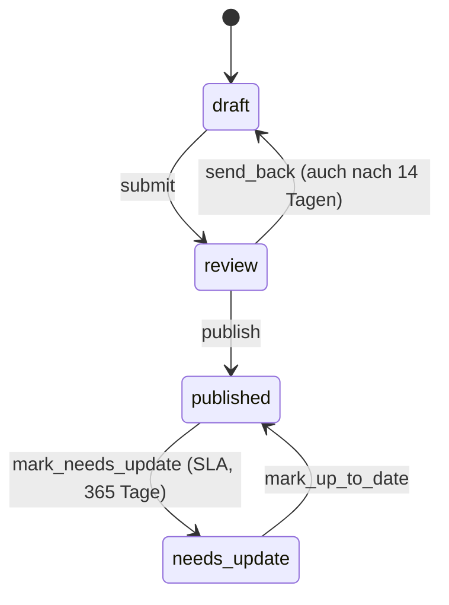

# Workflows definieren

🇬🇧 [English](../en/workflows.md)

Ein Workflow ist eine YAML-Datei in deinem Projekt. Sie beschreibt, welche Schritte ein Eintrag durchläuft, wer welchen Schritt gehen darf und was dabei passiert.

## Wo Workflows liegen

Jeder Workflow ist eine Datei in `resources/workflows/`. Der Dateiname ist der Handle des Workflows:

```
resources/workflows/
├── postmanager.yaml
├── translation.yaml
└── plainlanguage.yaml
```

Das Addon liest **nur** dieses Verzeichnis. Es bringt drei Beispiele mit (`postmanager`, `translation`, `plainlanguage`), im eigenen Ordner `resources/workflows/examples/`. Das sind Vorlagen, kein Ersatz: Einen Workflow gibt es in deinem Projekt erst, wenn seine YAML in `resources/workflows/` liegt.

Es gibt drei Wege, einen Workflow anzulegen:

- Im Control Panel unter **Einstellungen > Workflows > Workflow anlegen** (leer, aus einer mitgelieferten Vorlage oder als Kopie). Siehe [Workflow-Editor](editor.md).
- Auf der Kommandozeile:

  ```bash
  php artisan workflows:make press --collection=press_releases --label="Pressemitteilung"
  php artisan workflows:make postmanager --from=postmanager
  ```

- Indem du die YAML von Hand schreibst.

> [!NOTE]
> Das Addon prüft eine Definition, wenn du sie im Graph-Editor speicherst oder mit `workflows:make` anlegst. Eine von Hand bearbeitete Datei wird so gelesen, wie sie ist. Öffne sie danach im Editor: Die Problemliste zeigt alles, was das Speichern ablehnen würde.

> [!TIP]
> Speichert der Graph-Editor einen Workflow, schreibt er die YAML neu, und deine Kommentare gehen verloren. Die vorherige Datei bleibt als Backup in `storage/app/workflows/backups/<handle>/` erhalten (siehe `editor_backups` unter [Konfiguration](configuration.md)).

## Aufbau

Ein Workflow ist eine State-Machine von [Symfony Workflow](https://symfony.com/doc/current/workflow.html), ergänzt um Metadaten des Addons.

```yaml
name: press                     # entspricht immer dem Dateinamen
type: state_machine
marking_store: { type: method, property: current_state }
collections: [press_releases]   # die Collections, die dieser Workflow verwaltet
initial_place: draft            # hier startet jeder neue Eintrag
active: true                    # optional; false schaltet den Workflow ab

metadata:
  # Einstellungen auf Workflow-Ebene, siehe unten

places:
  draft:
    label: 'Entwurf'
    metadata: {}                # Einstellungen auf Place-Ebene
  published:
    label: 'Veröffentlicht'
    metadata: { allow_publish: true }

transitions:
  publish:
    from: draft                 # ein Place oder eine Liste von Places
    to: published               # genau ein Place
    metadata:
      label: 'Veröffentlichen'  # Einstellungen auf Transition-Ebene
```

### Schlüssel auf oberster Ebene

| Schlüssel | Typ | Standard | Beschreibung |
| --- | --- | --- | --- |
| `name` | string | Dateiname | Wird bei jedem Speichern auf den Dateinamen gesetzt. |
| `type` | string | — | Immer `state_machine`. |
| `marking_store` | map | — | Immer `{ type: method, property: current_state }`. |
| `collections` | list | `[]` | Handles der Collections, die dieser Workflow verwaltet. Jeder Handle muss existieren. Siehe [Verwaltete Collections](#verwaltete-collections). |
| `initial_place` | string | — | Der Place, in dem jeder neue Eintrag startet. Muss einer der `places` sein. |
| `active` | bool | `true` | `false` schaltet den Workflow ab: Er verschwindet aus dem Dashboard, den Manager-Seiten und dem Eintrags-Editor. Definition und Verlauf bleiben erhalten. |
| `metadata` | map | `{}` | Einstellungen auf Workflow-Ebene. Siehe [Workflow-Metadaten](#workflow-metadaten). |
| `places` | map | — | Die Zustände. Mindestens einer ist Pflicht. |
| `transitions` | map | `{}` | Die Schritte zwischen den Zuständen. |

### Places

Ein Place ist ein Zustand, in dem ein Eintrag stehen kann. Sein Schlüssel ist der Place-Handle.

```yaml
places:
  review:
    label: { en: 'Review', de: 'Prüfung' }
    metadata:
      color: blue
      allow_publish: false
      actions:
        - type: reminder
          every_days: 3
```

`label` ist entweder ein einfacher String oder eine Map mit einem Namen je CP-Sprache (`en`, `de`). Das CP wählt den Namen eines Place in dieser Reihenfolge:

1. dein Name für die aktuelle CP-Sprache (aus der `label`-Map),
2. der Sprachdatei-Schlüssel `workflows::messages.state_<handle>`,
3. jeder andere Name, den du vergeben hast (ein einfacher String oder die andere Sprache),
4. der Handle, lesbar aufbereitet.

> [!NOTE]
> Ein einfacher String als `label` steht **unter** der Sprachdatei. Nimm die Map je Sprache, wenn dein eigener Name gewinnen soll.

> [!IMPORTANT]
> Place-Handles sind dauerhaft, sobald Einträge sie nutzen: Status, Verlauf und Übersetzungen speichern sie. Die Handles `pending_revision` (Place) sowie `mark_pending` und `publish_revision` (Transitions) sind reserviert. Siehe [Revisionen](#revisionen).

### Transitions

Eine Transition bewegt einen Eintrag von einem Place in einen anderen. Ihr Schlüssel ist der Transition-Handle.

```yaml
transitions:
  reject:
    from: [review, final_check]   # mehrere Ausgangs-Places
    to: draft
    metadata:
      label: 'Zurückweisen'
      variant: danger
      required_group: [editors, reviewers]
```

- `from` ist ein Place-Handle oder eine Liste von Handles.
- `to` ist genau ein Place-Handle.
- Der Button-Text kommt aus dem Sprachdatei-Schlüssel `workflows::messages.action_<handle>`, wenn es ihn gibt, sonst aus `metadata.label`, sonst aus dem aufbereiteten Handle.
- Die Reihenfolge der Transitions zählt: Die erste Transition ist der Start des Workflows, und der Editor hält ihr `from` auf dem Start-Place.

### Verwaltete Collections

`collections` legt fest, welche Einträge der Workflow verwaltet. Für Einträge dieser Collections

- ergänzt das Addon das Workflow-Panel im Eintrags-Editor,
- hängt die Veröffentlichung am Workflow-Status (siehe `allow_publish`),
- erscheinen sie auf der Manager-Seite des Workflows.

Mehrere Workflows dürfen dieselbe Collection nennen. Der Workflow, dessen Dateiname alphabetisch zuerst kommt, **besitzt** die Collection: Er legt dort Einträge an und steuert ihre Veröffentlichung. Jeder andere Workflow auf dieser Collection greift nur auf Einträge zu, die ihm ausdrücklich übergeben wurden. So läuft der Übersetzungsmanager neben dem Beitragsmanager auf `posts`.

Verwaltet ein Workflow mehr als eine Collection, teilt seine Manager-Seite „Alle Beiträge“ in einen Tab je Collection auf.

> [!WARNING]
> Entfernst du eine Collection aus einem Workflow, werden Status, Zuweisungen, Verlauf und Kommentare ihrer Einträge in diesem Workflow gelöscht. Die Einträge selbst bleiben unverändert. Der Editor fragt vorher nach.

## Workflow-Metadaten

Alles unter dem Schlüssel `metadata` auf oberster Ebene.

### Allgemein

| Schlüssel | Typ | Standard | Beschreibung |
| --- | --- | --- | --- |
| `label` | string | Handle | Der Anzeigename des Workflows. |
| `nav` | map | — | Gibt dem Workflow eine Manager-Seite unter `/cp/workflows/<slug>` und einen Eintrag unter **Einstellungen > Workflows**. Schlüssel: `label`, `slug`, `icon`, `order`. Siehe unten. |
| `detail` | string | — | `translation` macht den Workflow zu einem Lokalisierungs-Workflow mit einer Detailseite aus Quelle und Ziel. Siehe [Übersetzung & Einfache Sprache](localization.md). |
| `history_fields` | list | alle Felder | Feld-Handles, die der Verlaufs-Diff zeigt. Alles andere wird ignoriert. |
| `content_fields` | list | automatisch | Die Felder oberster Ebene, die der Inhalt dieses Workflows sind, in Lesereihenfolge. Jeder Handle muss in mindestens einem Blueprint der verwalteten Collections vorkommen und lesbar sein. Siehe [Inhaltsfelder](extending/content-fields.md). |
| `progress_orientation` | string | `horizontal` | Ausrichtung der Fortschrittsleiste auf der Detailseite: `horizontal` oder `vertical`. |
| `seed_published_place` | string | automatisch | Der Place, den nachgetragene Einträge bekommen, deren Arbeit schon getan ist. Nötig, wenn kein Place `allow_publish` hat (etwa ein Übersetzungsablauf, der in „Freigegeben“ endet). Muss ein Place dieses Workflows sein. |
| `editor` | map | — | Knotenpositionen und Ansicht des Graph-Editors. Schreibt der Editor; zur Laufzeit liest es niemand. |

`nav` im Einzelnen:

| Schlüssel | Typ | Beschreibung |
| --- | --- | --- |
| `slug` | string | URL-Segment der Manager-Seite. Steht fest, sobald der Workflow existiert: Der Editor ändert ihn nie. |
| `label` | string | Optional. Gilt so, wie es dasteht, in jeder CP-Sprache. Leer lassen, damit der Titel aus dem Sprachschlüssel `nav.<slug>` kommt. |
| `icon` | string | Name eines Statamic-Icons. Standard: `workflow`. |
| `order` | int | Position unter **Einstellungen > Workflows**. |

### Zuweisung und Anlegen

| Schlüssel | Typ | Standard | Beschreibung |
| --- | --- | --- | --- |
| `default_assignee_group` | string | — | Alle aktuellen Mitglieder dieser Nutzergruppe werden jedem Eintrag zugewiesen, der über die Manager-Seite angelegt wird. In einem Übersetzungsmanager dürfen Mitglieder dieser Gruppe außerdem Einträge in andere Sites überführen. |
| `assign_creator` | bool | `false` | Weist zusätzlich die Person zu, die den Eintrag angelegt hat. |
| `post_creator_groups` | list | Config | Nutzergruppen, die den „Neuer Beitrag“-Button sehen. Überschreibt `post_creator_groups` in `config/workflows.php`. Leer heißt: nur Super-Admins. Gilt nicht für Lokalisierungs-Workflows. |
| `assigner_groups` | list | Config | Nutzergruppen, die ändern dürfen, wer für einen Eintrag zuständig ist. Überschreibt `assigner_groups` in der Config. Leer heißt: nur Super-Admins. |
| `create_transition` | string | — | Die Transition, die der „Neuer Beitrag“-Dialog direkt nach dem Anlegen ausführt. Sie muss aus dem Start-Place herausführen, darf keine System-Transition sein und ist nur in Eintrags-Workflows erlaubt. |
| `self_assignment` | map | — | Verhindert, dass ein Eintrag an die klickende Person zurückgeht. Siehe unten. |
| `four_eyes` | map | — | Verhindert, dass ein Eintrag an die Person zurückgeht, die ihn zuletzt weitergegeben hat. Siehe unten. |

`self_assignment` und `four_eyes` haben dieselbe Form: eine Zielgruppe, die die Auswahl stattdessen anbietet, wenn die Regel niemanden mehr übrig lässt.

```yaml
metadata:
  self_assignment:
    by: group                  # group | role | user
    handles: [project_leads]
    hint: ''                   # optionaler Hinweis über der Auswahl; leer = Standardtext
  four_eyes:
    by: group
    handles: [managing_editors]
```

Wie die beiden Regeln wirken, steht unter [Berechtigungen](permissions.md#zuweisungs-sperren).

### Bearbeiten und Kommentare

Diese Schlüssel nutzen **Zielgruppen-Zeilen**: eine Liste von `{by, handles}`-Einträgen, bei denen `by` `group`, `role` oder `user` (Nutzer-IDs) ist. Wer auf irgendeine Zeile passt, ist dabei.

```yaml
metadata:
  assignees_only_edit: true
  edit_exempt:
    - by: group
      handles: [managing_editors]
  comment_resolvers:
    - by: role
      handles: [editor_in_chief]
  comment_deleters:
    - by: user
      handles: ['a1b2c3']
```

| Schlüssel | Typ | Standard | Beschreibung |
| --- | --- | --- | --- |
| `assignees_only_edit` | bool | `false` | Nur die aktuell Zuständigen dürfen einen Eintrag bearbeiten; alle anderen sehen ihn schreibgeschützt. Super-Admins dürfen immer. |
| `edit_exempt` | Zielgruppen-Zeilen | — | Wer trotz `assignees_only_edit` bearbeiten darf. |
| `comment_resolvers` | Zielgruppen-Zeilen | — | Wer Kommentar-Threads als erledigt markieren und wieder öffnen darf. Ist der Schlüssel gesetzt, ersetzt er die Standardregel. |
| `comment_deleters` | Zielgruppen-Zeilen | — | Wer beliebige Kommentare löschen darf. Ist der Schlüssel gesetzt, ersetzt er `comment_moderator_groups` aus der Config. |

### Revisionen

| Schlüssel | Typ | Standard | Beschreibung |
| --- | --- | --- | --- |
| `revisions` | bool | — | `true` oder `false` wird beim Speichern in die YAML jeder verwalteten Collection geschrieben. Fehlt der Schlüssel, bleiben die Collections, wie sie sind. Setzt Statamic Pro und `STATAMIC_REVISIONS_ENABLED` voraus. |
| `revision_publishers` | Zielgruppen-Zeilen | — | Wer eine Arbeitskopie veröffentlichen darf, solange eine existiert. |

Hat eine verwaltete Collection Revisionen aktiv, ergänzt das Addon nach deinem Veröffentlichungs-Place einen Place `pending_revision` („Unveröffentlichte Änderungen“) sowie die zwei System-Transitions `mark_pending` und `publish_revision`. Der Eintrag wechselt automatisch zwischen ihnen, wenn Arbeitskopien entstehen und veröffentlicht werden. Lege diese Handles nicht selbst an.

### Inhaltsalterung (SLA)

Verschiebt einen veröffentlichten Eintrag nach einer Anzahl Tage in einen eigenen Place. Nur für Eintrags-Workflows, nicht für Lokalisierungs-Workflows.

```yaml
metadata:
  sla:
    needs_update_days: 365
    needs_update_place: needs_update
    needs_update_assign: { by: group, handles: [editors] }   # optional
    outdated_days: 540
    outdated_place: outdated
```

| Schlüssel | Typ | Beschreibung |
| --- | --- | --- |
| `needs_update_days` / `outdated_days` | int | Tage seit der letzten Freigabe. Ganze Zahl ab `0`. |
| `needs_update_place` / `outdated_place` | string | Der Place, in den der Eintrag wandert. Muss ein Place dieses Workflows sein. |
| `needs_update_assign` / `outdated_assign` | map | Optional `{by, handles}`: wer beim Ankommen übernimmt. Leer behält die bisherigen Zuständigen. |

Tage und Place gehören zusammen: Eine Stufe mit nur einem von beiden wird abgelehnt. Die zweite Stufe darf nicht vor der ersten liegen. Siehe [Inhaltsalterung (SLA)](sla.md).

### Lokalisierung

Nur mit `detail: translation` sinnvoll. Siehe [Übersetzung & Einfache Sprache](localization.md).

| Schlüssel | Typ | Beschreibung |
| --- | --- | --- |
| `translation_source_site` | string | Die Site, aus der übersetzt wird. Leer heißt: die Main-Site. Muss eine eingerichtete Site sein. |
| `translation_source_pick` | bool | Lässt den Sprachdialog auch die Quelle anbieten. Nicht zusammen mit `plain_language_site` erlaubt. |
| `translation_source_view` | list | Regeln `{mode, by, handles}`, wer die Quellspalte wie sieht. `mode`: `hidden` oder `collapsed`. |
| `source_draft_place` | string | Wohin eine Fassung geht, wenn ihr Quelleintrag auf Entwurf fällt. Darf kein `allow_publish` haben. |
| `translation_exclude_fields` | list | Feld-Handles oberster Ebene, die die Übersetzung unberührt lässt. |
| `site_fields` | list | Blueprint-Felder, mit denen Redakteure Sites von Hand wählen. Wird angenommen und geprüft, hat derzeit aber keine Wirkung. |
| `plain_language_site` | string | Macht diesen Workflow zum Einfache-Sprache-Manager und nennt seine Ziel-Site. |
| `plain_language_completed_place` | string | Wohin eine Fassung wandert, sobald ihre Umschreibung da ist. Setzt `plain_language_site` voraus. |
| `plain_language_failed_place` | string | Wohin eine Fassung wandert, wenn ihre Umschreibung endgültig scheitert. Ohne diesen Schlüssel wird die unübersetzte Kopie gelöscht. Setzt `plain_language_site` voraus. |
| `plain_language_skip_fields` | list | Felder, die nie an den Dienst gehen: `field`, `set.field` oder `*.field`. Setzt `plain_language_site` voraus. |
| `plain_language_clear_fields` | list | Felder, die eine fertige Umschreibung in der Einfache-Sprache-Fassung leert. Setzt `plain_language_site` voraus. |
| `qs_notes_visible` | bool | `false` verbirgt den Prüfbericht des Dienstes vor allen. Standard: `true`. |
| `qs_notes_audience` | Zielgruppen-Zeilen | Ist der Schlüssel gesetzt, sehen nur Super-Admins und diese Personen den Prüfbericht. |

## Place-Metadaten

Alles unter `places.<handle>.metadata`.

| Schlüssel | Typ | Standard | Beschreibung |
| --- | --- | --- | --- |
| `allow_publish` | bool | `false` | Kommt ein Eintrag hier an, wird er veröffentlicht; in jedem anderen Place wird er zurückgezogen. Greift nur, wenn mindestens ein Place des Workflows `allow_publish` hat. |
| `color` | string | je Handle | Badge-Farbe. Eine von `default`, `black`, `white`, `blue`, `sky`, `cyan`, `teal`, `green`, `emerald`, `lime`, `amber`, `yellow`, `orange`, `red`, `purple`, `violet`, `indigo`, `fuchsia`, `pink`, `rose`. |
| `branch` | bool | `false` | Nur Darstellung: Die Fortschrittsleiste zeichnet diesen Place als Abzweigung von der Hauptlinie, und nur, solange ein Eintrag darin steht. Auf dem Start-Place nicht erlaubt. |
| `actions` | list | `[]` | Verhalten, solange ein Eintrag in diesem Place steht. Siehe unten. |

> [!NOTE]
> `required_group` an einem **Place** hat keine Wirkung. Nur der Schlüssel an der Transition sperrt etwas. Der Editor entfernt ihn beim nächsten Speichern. `assign_group` an einem Place wird abgelehnt: Übergib einen Eintrag stattdessen mit einer [`user_assignment`](#user_assignment)-Action an der Transition.

### Place-Actions

Ein Place darf jeden Typ höchstens einmal tragen.

| `type` | Schlüssel | Beschreibung |
| --- | --- | --- |
| `mail` | `mail_type` | Wenn ein Eintrag hier **ankommt**, bekommt jeder, der ihm dann zugewiesen ist, eine Mail, auch wenn niemand geklickt hat. Bringt die Transition hierher selbst schon eine Mail mit, geht nur diese raus. |
| `reminder` | `every_days` (1–365), `mail_type` | Erinnert die Zuständigen alle X Tage, solange der Eintrag hier steht. Die erste Erinnerung geht X Tage nach dem Ankommen raus. Standard-Mail-Typ: `reminder`. |
| `auto_transition` | `after_days` (1–365), `transition` | Führt eine der eigenen ausgehenden Transitions dieses Place aus, wenn der Eintrag X Tage nach dem Ankommen noch hier steht. Die Transition muss in diesem Place starten und darf keine System-Transition sein. Ihre Zuweisung und Mail laufen wie bei einem Klick. |
| `refresh_interval` | `minutes` (1–1440) | Die Detailseite prüft nach X Minuten auf Änderungen und bietet ein Neuladen an, wenn sich etwas geändert hat. |
| `pending_rewrite_spinner` | — | Zeigt eine Ladeanzeige statt des Inhalts, solange eine Umschreibung in Einfache Sprache läuft. Setzt `plain_language_site` voraus. |

```yaml
places:
  review:
    metadata:
      actions:
        - type: reminder
          every_days: 3
        - type: auto_transition
          after_days: 14
          transition: send_back
```

Erinnerungen und automatische Transitions laufen einmal täglich über den Scheduler. Siehe [Benachrichtigungen](notifications.md) und [Befehle & Scheduler](commands.md).

Projekteigene Place-Actions aus `config/workflows.php` schreibst du als `type: <handle>` mit ihren Einstellungen unter `values:`. Siehe [Actions](extending/actions.md).

## Transition-Metadaten

Alles unter `transitions.<handle>.metadata`.

| Schlüssel | Typ | Standard | Beschreibung |
| --- | --- | --- | --- |
| `label` | string | Handle | Button-Text, sofern die Sprachdatei kein `action_<handle>` hat. |
| `variant` | string | `primary` | Button-Stil: `default`, `primary`, `danger` oder `filled`. Eine Transition namens `reject` ist standardmäßig `danger`. |
| `required_group` | string oder list | — | Die klickende Person muss in einer dieser Nutzergruppen sein. |
| `required_role` | string oder list | — | Die klickende Person muss eine dieser Rollen haben. |
| `system` | bool | `false` | Erscheint nie als Button. Für Schritte, die das Addon selbst auslöst. |
| `actions` | list | `[]` | Schritte rund um die Transition. Siehe unten. |

`required_group` und `required_role` sind eine **Vereinigung**: Eine passende Gruppe oder Rolle genügt. Ohne beide darf jede zuständige Person den Schritt gehen. In jedem Fall muss die klickende Person dem Eintrag auch zugewiesen sein. Siehe [Berechtigungen](permissions.md#transitions-ausführen).

### Transition-Actions

| `type` | Schlüssel | Limit | Beschreibung |
| --- | --- | --- | --- |
| `user_assignment` | `mode`, `match`, `criteria` | 1 | Legt fest, wer den Eintrag übernimmt. |
| `mail` | `mail_type` | 1 | Mailt nach der Transition allen, die dem Eintrag zugewiesen sind. |
| `target_missing` | `site` | — | Sperrt die Transition, solange der Eintrag schon eine Fassung in `site` hat. |
| `start_localization` | — | 1 je Workflow | Markiert die Transition, die die Ziel-Fassung erzeugt. In einem Lokalisierungs-Workflow genau einmal Pflicht. |
| `plain_language_resubmit` | — | — | Schickt den Text erneut an den Dienst für Einfache Sprache und überschreibt diese Fassung mit dem Ergebnis. Setzt `plain_language_site` voraus. |

Höchstens eine Action je Transition darf einen Dialog öffnen. Das ist heute eine manuelle `user_assignment`.

#### `user_assignment`

```yaml
actions:
  - type: user_assignment
    mode: manual          # manual | automatic
    match: all            # all | any
    criteria:
      - { field: group, operator: is, value: reviewers }
      - match: any        # eine verschachtelte Gruppe, eine Ebene tief
        criteria:
          - { field: role, operator: is, value: senior }
          - { field: role, operator: is, value: lead }
```

- `mode: manual` (Standard) öffnet eine Auswahl. Mehrere Personen sind wählbar.
- `mode: automatic` weist ohne Dialog alle Treffer zu. Dafür braucht es mindestens ein Kriterium, das die Nutzer eingrenzt, sonst wird das Speichern abgelehnt. Gibt es keinen Kandidaten, ist der Button gesperrt.
- `match` verknüpft die Kriterien: `all` (Standard) oder `any`.
- Einträge in `criteria` sind `{field, operator, value}`. Eingebaute Felder: `group` und `role`. Operatoren: `is`, `is_not` sowie `matches_entry` für Kriterien, die ein Nutzerfeld mit einem Eintragsfeld vergleichen. Werte werden nicht geprüft, du kannst also Gruppen oder Rollen nennen, die es noch nicht gibt.
- Eine Kriteriengruppe (`match` plus `criteria`) lässt sich eine Ebene tief verschachteln.

Die gewählten bzw. getroffenen Personen ersetzen die Zuständigen. **Eine Transition ohne `user_assignment` lässt die Zuständigen unverändert.** Weil nur Zuständige Transitions ausführen dürfen, braucht ein Workflow Übergaben an seinen Transitions, sonst kommen spätere Gruppen nie an den Eintrag.

Eigene Kriterien ergänzt du in der Config. Siehe [Zuweisungs-Kriterien](extending/assignment-criteria.md).

#### `mail`

```yaml
actions:
  - type: mail
    mail_type: assigned   # optional; Standard: assigned
```

Läuft nach der Transition und kann sie deshalb nicht verhindern. Empfänger sind die Zuständigen **nach** der Transition; eine `user_assignment` an derselben Transition mailt also die neuen Personen. Jede Person bekommt die Mail in ihrer eigenen CP-Sprache.

Eingebaute Mail-Typen: `assigned`, `reminder`, `sla`, `plain_language_ready` und `published` (geht an Beobachter statt an Zuständige). Eigene ergänzt du in der Config. Siehe [Mail-Typen](extending/mail-types.md) und [Benachrichtigungen](notifications.md).

#### `target_missing`

```yaml
actions:
  - type: target_missing
    site: english
```

Eine stille Sperre: Der Button ist gesperrt (mit Begründung), solange der Eintrag schon eine Fassung in `site` hat. Sie erlaubt nie etwas, das sonst gesperrt wäre. `site` muss eine eingerichtete Site sein.

#### Projekteigene Actions

Projekteigene Actions aus `config/workflows.php` schreibst du als `type: <handle>` mit ihren Einstellungen unter `values:`. Siehe [Actions](extending/actions.md).

### Alte Schreibweisen

| Alt | Verhalten |
| --- | --- |
| `type: notify_assignees` mit `mail:` | Wird als `mail` mit `mail_type` gelesen und beim nächsten Speichern umgeschrieben. |
| `type: account_reminder` | Fällt beim Speichern weg. Die Kontoerinnerung läuft jetzt bei jeder Transition. |
| `type: user_modal` | Wird abgelehnt. Nimm `user_assignment`. |
| `type: site_modal` | Wird abgelehnt. Nimm `start_localization`. |
| `plain_language_resubmit: true` an einer Transition, `pending_rewrite_spinner: true` an einem Place | Werden als Schalter weiter angenommen. Besser die Action-Form nutzen. |

## Vollständiges Beispiel

Ein Workflow für Pressemitteilungen: Entwurf, Prüfung mit Übergabe, Veröffentlichung und eine Alterungsstufe.

```yaml
name: press
type: state_machine
marking_store: { type: method, property: current_state }
collections: [press_releases]          # muss eine bestehende Collection sein
initial_place: draft

metadata:
  label: 'Pressemitteilung'
  nav: { slug: press-releases, icon: media-news-paper, order: 1 }

  # Neue Einträge gehen an alle Redakteure plus die anlegende Person.
  default_assignee_group: editors
  assign_creator: true

  # Wer anlegen und wer neu zuweisen darf.
  post_creator_groups: [editors]
  assigner_groups: [managing_editors]

  # „Neuer Beitrag“ führt sofort `submit` aus und fragt nach einer Prüferin.
  create_transition: submit

  # Eine Prüferin kann den Eintrag nie direkt an die Person zurückgeben,
  # die ihn eingereicht hat; bleibt sonst niemand, wird die Chefredaktion angeboten.
  four_eyes:
    by: group
    handles: [managing_editors]

  history_fields: [title, content]

  # Nach einem Jahr online wandert der Eintrag nach `needs_update`.
  sla:
    needs_update_days: 365
    needs_update_place: needs_update

places:
  draft:
    label: { en: 'Draft', de: 'Entwurf' }
    metadata: { color: default }
  review:
    label: { en: 'Review', de: 'Prüfung' }
    metadata:
      color: blue
      actions:
        # Alle 3 Tage an die Prüfenden erinnern ...
        - type: reminder
          every_days: 3
        # ... und nach 14 Tagen ohne Entscheidung zurückschicken.
        - type: auto_transition
          after_days: 14
          transition: send_back
  published:
    label: { en: 'Published', de: 'Veröffentlicht' }
    metadata: { color: green, allow_publish: true }
  needs_update:
    label: { en: 'Needs update', de: 'Aktualisierung fällig' }
    # Bleibt online, gezeichnet als Abzweigung von der Hauptlinie.
    metadata: { color: amber, allow_publish: true, branch: true }

transitions:
  submit:
    from: draft
    to: review
    metadata:
      label: 'Zur Prüfung einreichen'
      required_group: editors
      actions:
        # Die klickende Person wählt eine oder mehrere Prüfende ...
        - type: user_assignment
          mode: manual
          criteria:
            - { field: group, operator: is, value: reviewers }
        # ... die eine Mail bekommen, sobald der Schritt gelaufen ist.
        - type: mail
          mail_type: assigned
  send_back:
    from: review
    to: draft
    metadata:
      label: 'Zurückschicken'
      variant: danger
      required_group: reviewers
      actions:
        # Zurück an alle Redakteure, ohne Dialog.
        - type: user_assignment
          mode: automatic
          criteria:
            - { field: group, operator: is, value: editors }
  publish:
    from: review
    to: published
    metadata: { label: 'Veröffentlichen', required_group: reviewers }
  mark_needs_update:
    # Der SLA-Scheduler führt diese Transition aus, wenn die Frist abläuft.
    from: published
    to: needs_update
    metadata: { label: 'Als aktualisierungsbedürftig markieren' }
  mark_up_to_date:
    from: needs_update
    to: published
    metadata: { label: 'Als aktuell markieren', required_group: editors }
```

Derselbe Workflow als Graph:



> [!TIP]
> `php artisan workflow:dump <handle>` gibt jeden Workflow als Mermaid-Quelltext aus.

## Nächste Schritte

- [Workflow-Editor](editor.md): Workflows visuell bauen und ändern.
- [Berechtigungen](permissions.md): wie Sperren, Zuweisungen und Gruppen zusammenspielen.
- [Benachrichtigungen](notifications.md): Mails, Erinnerungen und Mail-Typen.
- [Übersetzung & Einfache Sprache](localization.md): Lokalisierungs-Workflows.

---

← [Konfiguration](configuration.md) · [Doku-Start](README.md) · [Workflow-Editor](editor.md) →
