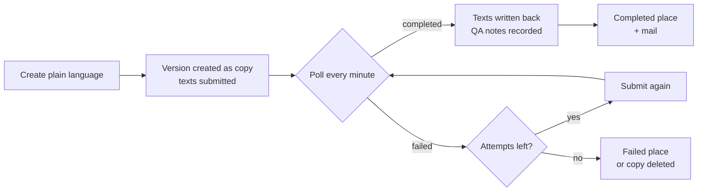

# Translation & plain language

🇩🇪 [Deutsch](../de/localization.md)

Localization workflows create and review the versions of an entry in other sites, translated by DeepL or rewritten into plain language by an external service.

## Localization workflows

A workflow becomes a localization workflow with one key:

```yaml
metadata:
  detail: translation
```

Its subject is no longer the entry as a whole but **one site version relative to its source**. That changes how the workflow behaves:

- **It creates no entries.** A localization workflow has no "New post" button. Creating entries belongs to the authoring workflow, even for super admins.
- **It owns every localization, the authoring workflow owns the source.** The German original of a post runs through the post workflow, its English version through the translation workflow. Each version has its own state, assignees, history and detail page per workflow.
- **It owns site distribution.** New versions are created by the workflow, not by hand. The entry editor hides Statamic's "Sites" card. Super admins and members of `privileged_groups` are exempt, so they can repair a broken localization.
- **It starts once the post is published.** Until the origin version is published in Statamic, the post has no state in a localization workflow. The detail page shows "Not started", and no transition leads out.
- **It shows source and target side by side.** The detail page compares the source version with the version under review.

The addon ships two examples in `resources/workflows/examples/`: `translation.yaml` (DeepL with linguistic and expert review) and `plainlanguage.yaml` (plain language with subject review). Copy them to `resources/workflows/` to use them. See [Defining workflows](workflows.md).

### Translation manager and plain-language manager

There are two kinds of localization workflow. One key decides which one a workflow is: `metadata.plain_language_site`.

| | Translation manager | Plain-language manager |
| --- | --- | --- |
| Declares `plain_language_site` | no | yes, exactly one site |
| Target site | picked in a language dialog | fixed: the `plain_language_site` |
| Service | DeepL, synchronous | plain-language service, asynchronous |
| Settings section in the editor | "Translation" | "Plain Language" |
| Env status rows in "Translation APIs" | `DEEPL_API_KEY` | `PLAIN_LANGUAGE_URL`, `PLAIN_LANGUAGE_TOKEN` |

A site claimed as `plain_language_site` is no longer a target for any other localization workflow. It drops out of the language dialog, out of the "Move to another site" dialog and out of their server-side checks.

Both managers can govern the same collection. The shipped examples both manage `posts` and `pages`. A post then has one state per manager: the `plain` version belongs to the plain-language manager, the `en` version to the translation manager.

> [!IMPORTANT]
> Place and transition handles must be unique across all workflows. Labels and colors are resolved globally by handle, first match wins. That is why `plainlanguage.yaml` uses `plain_ready`, `in_plain_language` and its own transition handles.

## Site versions and the source

### Which version is translated

Every manager translates from exactly one source version.

| Key | Type | Default | Description |
| --- | --- | --- | --- |
| `translation_source_site` | site handle | main site | The version to translate from. Empty means Statamic's default site; a post without a version there uses its origin. Set it to your plain-language site to build every translation on top of the plain-language version. |
| `translation_source_pick` | bool | `false` | The language dialog also asks for the source, preselected with `translation_source_site` and limited to versions the post has. Only in a translation manager, not in a plain-language manager. |

If a post has no version in the configured source site, the start transition stays disabled and says why. The manager never falls back to another source silently.

### The source must be finished

Translations start only from finished work. The source version must sit in the **last place** of the workflow that manages it:

| Source | Managed by | Required state |
| --- | --- | --- |
| Main site | Post workflow | the last place, typically `published` |
| Plain-language site | Plain-language manager | its last place, for example `plain_approved` |

Some details:

- A post with an unpublished working copy (`pending_revision`) counts as ready. The live version is published.
- A post moved into an ageing step is not ready. See [Content ageing (SLA)](sla.md).
- If no other workflow manages the source, the addon checks the published flag instead.
- The same rule applies to "Rewrite plain language".

Lists do not hide posts whose source is not ready. The row stays, only the button is disabled with a reason.

> [!NOTE]
> "Last place" means the order of places in the definition, minus reserved places such as `pending_revision` and ageing steps. If you append a place that comes after completion, "finished" moves with it.

### Only the source version starts a translation

On every other version, the start transition is disabled with "Translations start at the source version (…)". Rewriting plain language is likewise bound to the plain-language site.

### Site badges and language codes

Versions are listed under "Translations" on the detail page. Each version shows its site handle in uppercase as a badge, plus a language code. For the language code, the addon groups site handles by base site:

- A handle of the form `{base}_{lang}`, where `{base}` is itself a configured site, uses the suffix. `main` and `main_en` form one group, and `main_en` shows `EN`.
- Any other site uses the short form of its own locale.

The badge uses the handle, not the locale, on purpose. A plain-language site usually shares its locale with the original (`de_DE`), and the badge must still tell them apart.

## Starting a localization

### The `start_localization` action

One transition creates the target version. You mark it with the `start_localization` action:

```yaml
transitions:
  start_translation:
    from: source_ready
    to: in_translation
    metadata:
      label: 'Start translation'
      required_group: translator
      actions:
        - type: start_localization
```

- A localization workflow needs **exactly one** transition with this action. The settings editor refuses to save a workflow without it or with two.
- Outside a workflow with `detail: translation`, the action is rejected.
- The source stays in its place. The new version is created in the target site and receives the transition.

In the editor, the action is called "Creates the target version (with language picker)".

What happens on click depends on the manager:

- **Translation manager:** a dialog asks "Translate into which language?". It offers every site of the collection that has no version yet, minus claimed plain-language sites. With `translation_source_pick`, it also asks for the source. Then DeepL translates, and the version is created.
- **Plain-language manager:** no dialog. The version is created in `plain_language_site`, and the texts go to the service. The button is disabled while a version exists or a rewrite is running.

You can put review steps before the start. The marked transition does not have to leave the initial place:

```yaml
transitions:
  review_source:
    from: plain_ready
    to: plain_reviewed
    metadata: { label: 'Source reviewed', required_group: editor }
  start_plain_language:
    from: plain_reviewed
    to: in_plain_language
    metadata:
      label: 'Create plain language'
      actions:
        - type: start_localization
```

> [!NOTE]
> The start transition only appears where its `from` is reachable. Check the `from` field when you move the marker.

### The `target_missing` gate

`target_missing` blocks a transition as long as a named site already has a version of the post. It works on any transition, in any workflow:

```yaml
transitions:
  review_source:
    from: plain_ready
    to: plain_reviewed
    metadata:
      label: 'Source reviewed'
      actions:
        - type: target_missing
          site: plain
```

- The gate only blocks, it never grants. Assignee, group and every other check still apply.
- A blocked button shows "A version in … already exists."
- A transition can carry several gates, and a gate can sit next to a dialog.
- The site must be a configured site, otherwise the editor refuses to save.

In the editor, the action is called "Gate: site must still be missing".

### Who gets the new version

Only assignees can run a transition. Give the new version somebody to work on it:

| Key | Description |
| --- | --- |
| `assign_creator: true` | Whoever started the localization is assigned to the new version. |
| `default_assignee_group` | Members of this group are assigned when a version is created. |

The creator assignment ends with the first transition.

## The translation manager

With `metadata.nav`, each localization workflow gets its own manager page at `/cp/workflows/<slug>`. The shipped examples use the slugs `translation-manager` and `plain-language-manager`.

The manager page shows:

- **"Translatable posts":** posts whose source version exists and is finished. Columns show the source site first, then the target sites, each with the version's state.
- **"Assigned to me"** and **"My posts"**. They only show versions in sites this manager reads or writes.

A row opens the source version. The version list on the detail page stays inside the current manager as long as it is responsible for the version.

### Hiding the source on the detail page

`translation_source_view` controls who sees the source column of the detail page:

```yaml
metadata:
  translation_source_view:
    - mode: collapsed
      by: group
      handles: [linguistic_reviewer]
    - mode: hidden
      by: role
      handles: [external_translator]
```

| Mode | Editor label | Effect |
| --- | --- | --- |
| `hidden` | "Translation only" | The source is not sent to the browser at all. |
| `collapsed` | "Source collapsed" | The page opens with one column. A button reveals the source. |

`by` is `group`, `role` or `user`; `handles` lists group or role handles or user IDs. Users no rule matches see both columns. If several rules match, the stricter one wins. This is a display rule, not a permission: it applies to super admins too.

You edit the rules in the workflow settings under "Source view per audience". See [Workflow editor](editor.md).

## DeepL machine translation

The translation manager uses DeepL. Set `DEEPL_API_KEY` in your `.env`; the setup is described in [Translation & plain language (extending)](extending/translation.md).

### What happens on start

1. The addon extracts every translatable text of the source version.
2. DeepL translates the texts. The whole run is limited to 45 seconds.
3. Only when everything is translated is the new version created and the transition applied.

If DeepL fails, nothing is created. The editor sees a message such as "The DeepL API key was rejected." or "The DeepL quota is used up." Without an API key, the version is created as a 1:1 copy of the source.

### What gets translated

The blueprint decides. The addon walks all fields of the entry and translates:

- `text`, `textarea` and `markdown` fields,
- Bard fields, including text inside their sets,
- text inside Replicator rows, Grid rows and Groups,
- the prose subkeys of an SEO Pro field (see [SEO handling](#seo-handling)).

Never translated: `slug`, `date`, `published`, and the top-level fields listed in `metadata.translation_exclude_fields`:

```yaml
metadata:
  translation_exclude_fields: [author_note, internal_id]
```

`translation_exclude_fields` has no field in the editor. Set it in the YAML; the editor keeps it when saving.

> [!WARNING]
> Mark translated fields as `localizable: true` in the blueprint. Otherwise the translation is written but the publish form shows the origin's value, and the next save may overwrite it. The addon warns about such fields when it translates.

### Language codes

DeepL receives the source as a bare language (`DE`) and the target as a regional variant where one exists, based on the target site's locale: `en_GB` becomes `EN-GB`, `en` and `en_US` become `EN-US`, `pt_BR` becomes `PT-BR`.

## Plain language

The plain-language manager sends texts to an external rewriting service. The service works asynchronously: a scheduled command collects the results. Credentials, scheduler and limits are described in [Translation & plain language (extending)](extending/translation.md).

### Lifecycle



1. **Submit.** The start transition creates the version as a copy of the source and submits the content. The detail page shows "Rewriting into plain language …" if the place carries the spinner action. If the service refuses the submission right away, the copy is deleted and an error appears.
2. **Poll.** `workflows:plain-language-poll` runs every minute through the scheduler and asks the service for results.
3. **Write back.** A finished rewrite is written into the version, block by block. The title, the content fields and the SEO texts are updated.
4. **Retry.** A failed or timed-out submission is sent again, up to `max_attempts` submissions. The detail page shows "Attempt n of m".
5. **Finish.** On success, the version can move on automatically. After the last failed attempt, it moves to the failed place, or the copy is deleted.

> [!WARNING]
> Without the Laravel scheduler (or your own runner for `workflows:plain-language-poll`), a submitted rewrite is never written back. See [Commands & scheduler](commands.md).

### What is sent

The plain-language service receives the **content fields** of the workflow: `metadata.content_fields`, or the auto-detected fields if none are set. Each block of prose goes out as its own section and comes back to exactly the same place. Fields in `translation_exclude_fields` and the `seo` field are never sent. See [Content fields](extending/content-fields.md).

### Settings

All keys go under `metadata` and require `plain_language_site`.

| Key | Editor label | Description |
| --- | --- | --- |
| `plain_language_site` | "Target site" | The one site this manager writes into. Makes the workflow a plain-language manager. |
| `plain_language_completed_place` | "Target place after job completion" | Where a version moves once its rewrite is written back successfully. Without it, the version stays put until somebody clicks the next transition. |
| `plain_language_failed_place` | "Target place on failed translation" | Where a version moves once the rewrite has failed for good. Without it, the untouched copy is deleted. |
| `plain_language_skip_fields` | "Never rewrite" | Text fields that are never sent and keep their value: `field`, `set.field` or `*.field`. For anchor IDs, embed codes, button labels. |
| `plain_language_clear_fields` | – | Top-level fields emptied on the plain-language version after a rewrite, such as a reference list. YAML only. |

Both place moves skip transitions: no group check, no assignee change, no publish gate. Mails attached to the target place are still sent.

> [!TIP]
> Set `plain_language_completed_place`. It is the only way to send a "Plain language is ready" mail: give that place a `mail` action with `mail_type: plain_language_ready`. Without a state change, nothing can notify anybody. See [Notifications](notifications.md).

`plain_language_clear_fields` writes an explicitly empty value instead of removing the field. A removed value would fall back to the origin's text. The title and the content fields can never be cleared.

### Place actions for the waiting time

Two place actions help while a rewrite is running. Both need `plain_language_site`.

```yaml
places:
  in_plain_language:
    metadata:
      actions:
        - type: pending_rewrite_spinner
        - type: refresh_interval
          minutes: 10
```

| Type | Editor label | Effect |
| --- | --- | --- |
| `pending_rewrite_spinner` | "Loading spinner during rewrite" | Replaces the content with a spinner while a job is open. |
| `refresh_interval` | "Refresh after X minutes (with modal)" | After the given minutes (1–1440), asks the reader to reload once the rewrite has landed. |

### Failure and retry

A submission counts as failed when the service reports a failure, no longer knows the job, returns unusable output, answers with sections that don't match what was sent, or has not finished after `max_polls` polls. Each failed attempt is recorded in the history ("Attempt n of m failed: … Sent to the service again.").

After the last attempt:

- **With `plain_language_failed_place`:** the version moves there and stays. It is visible in the queue and on the dashboard.
- **Without it:** the untouched copy is deleted. Only a short message remains.

A version that already held a rewrite is never deleted.

Connection errors (DNS, TLS, timeout) don't count as an attempt. The next run tries again.

### Rewriting again: `plain_language_resubmit`

A transition with the `plain_language_resubmit` action creates nothing. It sends the source text to the service again and overwrites the existing plain-language version with the result.

```yaml
transitions:
  regenerate_plain_language:
    from: [plain_ready, in_plain_language, plain_generated, plain_review, plain_approved]
    to: in_plain_language
    metadata:
      label: 'Rewrite plain language'
      required_group: editor
      actions:
        - type: plain_language_resubmit
```

- Only allowed in a plain-language manager. Several transitions may carry it.
- Disabled while a rewrite is still running, and as long as no plain-language version exists.
- Include the initial place in `from`: the source version always sits there.
- Add your `plain_language_failed_place` to `from`, and a second attempt is one click.

In the editor, the action is called "Rewrite plain language".

The dashboard's statistics widget shows a "Failed translations" card with a "restart" link. It runs the transition out of the failed place for every parked version you may move. See [Dashboard widgets](extending/dashboard-widgets.md).

### Notes on the AI rewrite

The service can return a QA report: what it simplified, what it added and what it left out. The addon stores it with the post and shows it behind the **"Notes on the AI rewrite"** button on the detail page. The report does not appear in the comment thread.

When the version reaches `plain_language_completed_place`, the button is highlighted: "New review report — please read before approving."

Control who sees the button in the plain-language workflow:

```yaml
metadata:
  qs_notes_visible: true
  qs_notes_audience:
    - by: group
      handles: [medical_writer]
```

| `qs_notes_visible` | `qs_notes_audience` | Who sees the notes |
| --- | --- | --- |
| `false` | – | nobody |
| `true` (default) | empty | everybody |
| `true` | rows | super admins and users matching any row |

Each row has `by` (`group`, `role` or `user`) and `handles`. In the editor, the settings are "Show QA notes" and "Show QA notes to:" in the plain-language section.

> [!NOTE]
> The report is only collected from a successful rewrite, and only if the service sends it as text.

## SEO handling

**Translation (DeepL).** These subkeys of an SEO Pro field are translated: `title`, `description`, `og_title`, `twitter_title`, `twitter_description`. All others (images, robots, URLs, handles) keep their value.

**Plain language.** `seo` is never sent to the service. Instead, the addon derives two values from the rewrite:

- `seo.title`: the rewritten title.
- `seo.description`: the first paragraph of the rewritten intro, or of the first rich-text block. Cut at a word boundary to at most 160 characters.

The rest of the SEO array is kept. A resubmit derives both values again and overwrites manual changes.

On both paths, two values are never touched:

- `seo: false` (SEO Pro switched off for the entry),
- `@seo:<handle>` references to another field.

> [!WARNING]
> Translations and derived titles are not shortened. SEO Pro recommends 60 characters for the title and 160 for the description. The publish form shows the warning on the next save.

## Backfilling plain-language versions

Versions rewritten before SEO derivation or `plain_language_clear_fields` existed still carry the original's meta texts and cleared fields. The backfill command applies both rules to them:

```bash
# Preview: before → after per subkey and field
php artisan workflows:backfill-plain-language --dry-run

# Only one plain-language workflow
php artisan workflows:backfill-plain-language --workflow=plainlanguage

# Also overwrite values edited after the rewrite
php artisan workflows:backfill-plain-language --force
```

| Option | Description |
| --- | --- |
| `--workflow=` | Only this plain-language workflow. Default: all workflows with `plain_language_site`. |
| `--force` | Overwrite values that were edited after the rewrite. |
| `--dry-run` | Report what would be written, change nothing. |

What it does, per version in the plain-language site:

1. Derives `seo.title` and `seo.description` from the version's own content.
2. Empties the fields in `plain_language_clear_fields`.

It skips versions with a rewrite still running and versions that were never rewritten. `seo: false` skips only the SEO part. Values somebody edited after the rewrite are kept and reported as `edited`, unless you pass `--force`.

The command writes no history events and is idempotent: a second run reports everything as `unchanged`.

## Reference: localization keys

All keys go under `metadata` of a localization workflow.

| Key | Type | Description |
| --- | --- | --- |
| `detail` | `translation` | Makes the workflow a localization workflow. |
| `plain_language_site` | site handle | Makes it a plain-language manager with this target site. |
| `translation_source_site` | site handle | Source version. Default: main site. |
| `translation_source_pick` | bool | Ask for the source in the language dialog. Translation manager only. |
| `translation_source_view` | list | Who sees the source column how. |
| `translation_exclude_fields` | list | Top-level fields never translated or rewritten. |
| `plain_language_completed_place` | place | Where a finished rewrite moves the version. |
| `plain_language_failed_place` | place | Where a failed rewrite moves the version. |
| `plain_language_skip_fields` | list | Text fields never sent to the plain-language service. |
| `plain_language_clear_fields` | list | Fields emptied after a rewrite. |
| `qs_notes_visible` | bool | Show the QA notes. Default `true`. |
| `qs_notes_audience` | list | Who sees the QA notes. |
| `source_draft_place` | place | Where this version falls back when the post goes to draft. See [Content ageing (SLA)](sla.md). |
| `seed_published_place` | place | State for already localized posts when seeding states. See [Commands & scheduler](commands.md). |

Transition actions: `start_localization`, `target_missing` (with `site`), `plain_language_resubmit`. Place actions: `pending_rewrite_spinner`, `refresh_interval` (with `minutes`).

## Next steps

- [Translation & plain language (extending)](extending/translation.md): credentials, scheduler and service limits
- [Content fields](extending/content-fields.md): which fields count as content
- [Content ageing (SLA)](sla.md): what happens to versions when the source ages
- [Commands & scheduler](commands.md): poll and backfill commands

---

← [Notifications](notifications.md) · [Docs home](README.md) · [Content ageing (SLA)](sla.md) →
