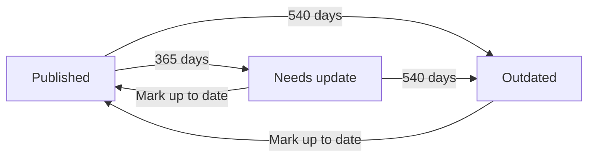

# Content ageing (SLA)

🇩🇪 [Deutsch](../de/sla.md)

Move published entries into review steps of your own once they have gone too long without an update, and take their translations offline with them when needed.

## Overview

Content ageing has three parts. You can use each on its own.

| Part | What it does | Where you set it |
| --- | --- | --- |
| The clock | `content_updated_at` on every entry version: the date its content was last approved. | Set automatically |
| The stages | After X days, move the entry into a place of your choice. Up to two stages. | `metadata.sla` in the authoring workflow |
| The cascade | When the entry goes offline, its translations follow into a place of their choice. | `metadata.source_draft_place` in each localization workflow |

Translations that are not moved still show an "out of date" marker once their source has been approved again (see [The derived "out of date" marker](#the-derived-out-of-date-marker)).



## The clock

Every entry in a collection of an authoring workflow gets the date field `content_updated_at`, labeled "Content updated". You don't add it to the blueprint; the addon does. Each language version carries its own value.

The clock is set to today when a version:

- arrives in a place with `allow_publish` through a transition, for example "Publish" or "Mark up to date", or
- has its working copy published (with Statamic revisions).

Arriving in the "Unpublished changes" state doesn't set it. A normal save doesn't set it either, so fixing a typo doesn't extend a deadline.

A version that has never been stamped falls back to its publication date (`date`), and failing that to the file's last-modified date.

### Who may change it

Everyone sees the field in the entry editor. Only super admins can edit it; for everyone else it is read-only, and the addon also keeps the old value when someone else saves. The "Content updated" column in the manager pages shows the same value and can be sorted by it.

By default the field is placed in the blueprint's first tab. To place it elsewhere, add the handle to your blueprint with only its type:

```yaml
-
  handle: content_updated_at
  field:
    type: date
```

The addon fills in everything else. Don't set `visibility` in the YAML: it would apply to everyone and override the super-admin rule.

### Backfilling existing content

To give existing content its own stored value, run once:

```bash
php artisan workflows:backfill-content-timestamp --dry-run
php artisan workflows:backfill-content-timestamp
```

| Option | Description |
| --- | --- |
| `--workflow=` | Only the collections of this workflow. Default: all authoring workflows. |
| `--force` | Also overwrite versions that already have a value. |
| `--dry-run` | Report what would be written, change nothing. |

It writes the same value the fallback would produce, so deadlines don't change. You need it for the per-version comparison behind the "out of date" marker.

## Configuring the stages

The stages are ordinary places of your workflow, with their own handle, label, color and `allow_publish`. `metadata.sla` only says when the entry moves into which of them.

```yaml
metadata:
  sla:
    needs_update_days: 365
    needs_update_place: needs_update
    outdated_days: 540
    outdated_place: outdated

places:
  published:
    label: 'Published'
    metadata: { allow_publish: true }
  needs_update:
    label: 'Needs update'
    metadata: { allow_publish: true, color: amber, branch: true }
  outdated:
    label: 'Outdated'
    metadata: { color: red, branch: true }

transitions:
  mark_up_to_date:
    from: [needs_update, outdated]
    to: published
    metadata: { label: 'Mark up to date' }
```

| Key | Type | Default | Description |
| --- | --- | --- | --- |
| `needs_update_days` | `int` | – | Age in days for the first stage. `0` means at the next scheduler run. |
| `needs_update_place` | `string` | – | Place handle of the first stage. |
| `needs_update_assign` | `object` | – | Optional. Who becomes responsible on arrival: `{by: group\|role\|user, handles: [...]}`. |
| `outdated_days` | `int` | – | Age in days for the second stage. Must be at least `needs_update_days`. |
| `outdated_place` | `string` | – | Place handle of the second stage. |
| `outdated_assign` | `object` | – | Optional. As `needs_update_assign`, for the second stage. |

Both stages are optional, but days and place only work together. A stage with only one of them is rejected when you save. You can also set all of this in the [workflow editor](editor.md) on the "SLA" tab: "First stage after X days", "First stage: step", "First stage: responsible" and the same for the second stage.

```yaml
metadata:
  sla:
    needs_update_days: 365
    needs_update_place: needs_update
    needs_update_assign:
      by: group
      handles: [editor]
```

When saving, the addon checks that:

- `sla` sits in an authoring workflow, not a localization workflow,
- each stage's place exists in this workflow,
- days are empty or a whole number from `0`,
- the second stage doesn't come before the first.

### How to design the stages

- **`allow_publish` decides whether the entry stays online.** A stage place without `allow_publish` unpublishes the entry when it arrives there, and with it every translation that has a `source_draft_place`. If the first stage is only meant as a reminder ("due for an update, but still online"), give it `allow_publish: true`.
- **The way back is up to you.** Add a transition from the stage places back to your publish place, such as "Mark up to date". Arriving in the publish place restarts the clock. List both stage places in its `from`, or an outdated entry gets stuck.
- **The way in is optional.** You don't need a transition into a stage place; the scheduler moves the entry anyway. Add one when the move should run actions, for example hand the entry to someone with `user_assignment` or send a `mail`.
- **Stage places stay off the main line.** The addon leaves them out of the progress bar's main line and doesn't treat them as the workflow's final step. `branch: true` draws them hanging off the line in the editor and the progress bar.
- **Notify with the `sla` mail type.** Put a `mail` action with `mail_type: sla` on the stage place or on the transition into it. The mail says the post hasn't been updated since its last approval and asks for a review. See [Notifications](notifications.md#mail-types).

## The hourly task

`php artisan workflows:transition-aged` moves aged entries. The addon registers it with the Laravel scheduler to run every hour.

| Key | Env | Default | Description |
| --- | --- | --- | --- |
| `sla_scheduler` | `WORKFLOWS_SLA_SCHEDULER` | `true` | Registers the hourly task. `false` turns ageing off globally; the command stays available for manual runs. |

Workflows without a `metadata.sla` block are never touched.

> [!IMPORTANT]
> The task only runs if `php artisan schedule:run` is on cron in your project:
>
> ```bash
> * * * * * cd /path/to/project && php artisan schedule:run >> /dev/null 2>&1
> ```

For each workflow with an `sla` block, a run:

1. Skips localization workflows, with a warning.
2. Collects the versions in a publish place (not "Unpublished changes") and, if configured, in the first stage.
3. Computes each version's age in days from its clock.
4. Picks the target, checking the second stage first: an entry old enough for both goes straight into the second stage.
5. Leaves the entry alone if it is already in the target place or not old enough.
6. If the stage has its own `_assign`, makes those people responsible. If nobody matches, the current assignees stay and the run prints a warning.
7. Moves the entry:
   - **With a transition** from the current place into the target: the transition runs like a click, without a person. Its automatic assignment, its mail and the published flag work as defined.
   - **Without one:** the entry is moved straight in. The published flag follows the target's `allow_publish`, the target's `mail` action fires, and the history notes "Not updated for N days." Responsibility stays where it was, unless the stage has `_assign`.

A version without any date to measure from is never moved.

## The cascade: translations follow

When an entry goes offline, its translations would otherwise stay online without a source. A localization workflow can therefore name a place its versions fall back to:

```yaml
# In the localization workflow, e.g. plainlanguage.yaml
metadata:
  source_draft_place: plain_ready
```

In the editor, this is "When the source is in draft" › "Back into step".

The cascade reacts to the entry's published flag, not to a specific place. It fires whenever the original entry is saved unpublished, through an ageing stage without `allow_publish` or by someone unpublishing it by hand. Then, for each other language version:

1. The version's own workflow is checked for `source_draft_place`. Without one, nothing happens.
2. A version whose plain-language rewrite is still running is skipped.
3. Otherwise the version is moved into that place and unpublished. The history notes "The entry is in draft — this version followed it." The place's `mail` action fires.

The versions don't come back by themselves. They show up again in their manager and go through their own workflow, for example a new plain-language rewrite.

Rules checked on save:

- `source_draft_place` belongs in a localization workflow,
- the place must exist there,
- the place must not have `allow_publish`, because the version is meant to be offline there.

## The derived "out of date" marker

A stage that leaves the entry online moves no translations. They can still be behind. The addon compares clocks instead:

A version counts as out of date when:

- it is a translation, not the original entry,
- it sits in its own workflow's publish place or final place (a version still in progress is not out of date), and
- the original entry's clock is newer than the version's own clock, or the version has none.

Out-of-date versions show an "out of date" marker next to their state badge in the manager pages and on the summary's translation list. "All posts" offers the filter "Up to date" › "Only with an out-of-date version" as soon as one exists.

> [!NOTE]
> The comparison always uses the original entry's clock, even in a chain such as original → plain language → English. If only the plain-language version is revised, the English translation is not marked out of date.

## Testing by hand

```bash
# What would happen?
php artisan workflows:transition-aged --dry-run

# Run it for one workflow
php artisan workflows:transition-aged --workflow=postmanager
```

To test without waiting a year, set a stage's days to `0` temporarily. The entry then moves at the next run. As a super admin, you can also set an entry's "Content updated" date back in the entry editor.

The bundled example `resources/workflows/examples/postmanager.yaml` contains a complete setup: two ageing places, transitions into and out of them, and the `sla` block.

## Notes & limitations

> [!WARNING]
> If a stage place has `allow_publish: true` and the entry reaches it through a transition, that arrival counts as an approval and restarts the clock. The second stage is then measured from the arrival in the first stage, not from the original approval. A direct move (no transition into the stage) doesn't restart the clock.

> [!NOTE]
> Transitions run by the task have no person behind them. Their `required_group` and `required_role` are not checked. Only automatic assignments run; a manual assignment can't open a picker.

> [!NOTE]
> Entering "Unpublished changes" (a working copy) is not an approval. Publishing the working copy is.

## Next steps

- [Notifications](notifications.md): the `sla` mail type and mails on arrival.
- [Translation & plain language](localization.md): localization workflows and their places.
- [Commands & scheduler](commands.md): cron setup and every scheduled task.
- [Defining workflows](workflows.md): places, transitions and their metadata.

---

← [Translation & plain language](localization.md) · [Docs home](README.md) · [Permissions](permissions.md) →
