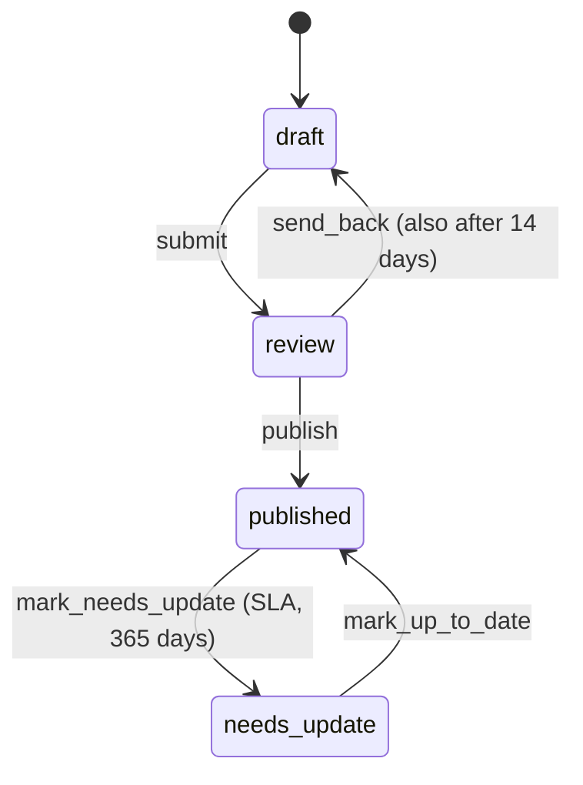

# Defining workflows

🇩🇪 [Deutsch](../de/workflows.md)

A workflow is a YAML file in your project that describes the steps an entry goes through, who may take each step, and what happens along the way.

## Where workflows live

Each workflow is one file in `resources/workflows/`. The file name is the workflow's handle:

```
resources/workflows/
├── postmanager.yaml
├── translation.yaml
└── plainlanguage.yaml
```

The addon reads **only** this directory. It ships three examples (`postmanager`, `translation`, `plainlanguage`) in its own `resources/workflows/examples/` folder, but they are templates, not fallbacks: a workflow exists in your project only once its YAML is in `resources/workflows/`.

You can create a workflow in three ways:

- In the Control Panel under **Settings > Workflows > Create workflow** (blank, from a shipped template, or as a copy). See [Workflow editor](editor.md).
- On the command line:

  ```bash
  php artisan workflows:make press --collection=press_releases --label="Press release"
  php artisan workflows:make postmanager --from=postmanager
  ```

- By writing the YAML by hand.

> [!NOTE]
> The addon validates a definition when you save it in the graph editor or create it with `workflows:make`. A file you edit by hand is read as it is. Open it in the editor afterwards: the problems list shows everything the save would refuse.

> [!TIP]
> When the graph editor saves a workflow, it rewrites the YAML and drops your comments. The previous file is kept as a backup in `storage/app/workflows/backups/<handle>/` (see `editor_backups` in [Configuration](configuration.md)).

## Structure

A workflow is a [Symfony Workflow](https://symfony.com/doc/current/workflow.html) state machine plus addon-specific metadata.

```yaml
name: press                     # always equals the file name
type: state_machine
marking_store: { type: method, property: current_state }
collections: [press_releases]   # the collections this workflow governs
initial_place: draft            # where every new entry starts
active: true                    # optional; false switches the workflow off

metadata:
  # workflow-level settings, see below

places:
  draft:
    label: 'Draft'
    metadata: {}                # place-level settings
  published:
    label: 'Published'
    metadata: { allow_publish: true }

transitions:
  publish:
    from: draft                 # one place or a list of places
    to: published               # exactly one place
    metadata:
      label: 'Publish'          # transition-level settings
```

### Top-level keys

| Key | Type | Default | Description |
| --- | --- | --- | --- |
| `name` | string | file name | Forced to the file name on every save. |
| `type` | string | — | Always `state_machine`. |
| `marking_store` | map | — | Always `{ type: method, property: current_state }`. |
| `collections` | list | `[]` | Handles of the collections this workflow governs. Every handle must exist. See [Governed collections](#governed-collections). |
| `initial_place` | string | — | The place every new entry starts in. Must be one of `places`. |
| `active` | bool | `true` | `false` switches the workflow off: it disappears from the dashboard, the manager pages and the entry editor. Its definition and history are kept. |
| `metadata` | map | `{}` | Workflow-level settings. See [Workflow metadata](#workflow-metadata). |
| `places` | map | — | The states. At least one is required. |
| `transitions` | map | `{}` | The steps between states. |

### Places

A place is a state an entry can be in. Its key is the place handle.

```yaml
places:
  review:
    label: { en: 'Review', de: 'Prüfung' }
    metadata:
      color: blue
      allow_publish: false
      actions:
        - type: reminder
          every_days: 3
```

`label` is either a plain string or a map with one name per CP language (`en`, `de`). The CP picks a place's name in this order:

1. your name for the current CP language (from the `label` map),
2. the language file key `workflows::messages.state_<handle>`,
3. any other name you gave (a plain string, or the other language),
4. the handle, humanized.

> [!NOTE]
> A plain string `label` ranks **below** the language file. Use the per-language map when you want your own name to win.

> [!IMPORTANT]
> Place handles are permanent once entries use them: states, history and translations store them. The handles `pending_revision` (place) and `mark_pending` / `publish_revision` (transitions) are reserved. See [Revisions](#revisions).

### Transitions

A transition moves an entry from one place to another. Its key is the transition handle.

```yaml
transitions:
  reject:
    from: [review, final_check]   # several source places
    to: draft
    metadata:
      label: 'Reject'
      variant: danger
      required_group: [editors, reviewers]
```

- `from` is a place handle or a list of handles.
- `to` is exactly one place handle.
- The button text comes from the language file key `workflows::messages.action_<handle>` when it exists, otherwise from `metadata.label`, otherwise from the humanized handle.
- The order of transitions matters: the first transition is the start of the workflow, and the editor keeps its `from` on the initial place.

### Governed collections

`collections` decides which entries the workflow manages. For entries in these collections the addon:

- adds the workflow panel to the entry editor,
- gates publishing on the workflow state (see `allow_publish`),
- lists them on the workflow's manager page.

Several workflows may list the same collection. The workflow whose file name comes first alphabetically **owns** the collection: it creates entries there and gates their publishing. Any other workflow on that collection only picks up entries that were explicitly handed to it (this is how the translation manager runs alongside the post manager on `posts`).

When a workflow governs more than one collection, its manager page splits "All posts" into one tab per collection.

> [!WARNING]
> Removing a collection from a workflow deletes the state, assignments, history and comments of its entries in that workflow. The entries themselves are untouched. The editor asks for confirmation first.

## Workflow metadata

Everything under the top-level `metadata` key.

### General

| Key | Type | Default | Description |
| --- | --- | --- | --- |
| `label` | string | handle | The workflow's display name. |
| `nav` | map | — | Gives the workflow a manager page at `/cp/workflows/<slug>` and an entry under **Settings > Workflows**. Keys: `label`, `slug`, `icon`, `order`. See below. |
| `detail` | string | — | `translation` turns the workflow into a localization workflow with a source/target detail page. See [Translation & plain language](localization.md). |
| `history_fields` | list | all fields | Field handles the history diff shows. Anything not listed is ignored. |
| `content_fields` | list | automatic | Top-level fields that are this workflow's content, in reading order. Each handle must exist in at least one blueprint of the governed collections and be readable. See [Content fields](extending/content-fields.md). |
| `progress_orientation` | string | `horizontal` | Layout of the progress bar on the detail page: `horizontal` or `vertical`. |
| `seed_published_place` | string | auto | The place backfilled entries get when their work is already done. Needed when no place has `allow_publish` (a translation flow that ends in "Approved", for example). Must be a place of this workflow. |
| `editor` | map | — | Node positions and viewport of the graph editor. Written by the editor; nothing at runtime reads it. |

`nav` in detail:

| Key | Type | Description |
| --- | --- | --- |
| `slug` | string | URL segment of the manager page. Fixed once the workflow exists: the editor never changes it. |
| `label` | string | Optional. Used as written, in every CP language. Leave it empty to take the title from the language key `nav.<slug>`. |
| `icon` | string | Statamic icon name. Defaults to `workflow`. |
| `order` | int | Sort position under **Settings > Workflows**. |

### Assignment and creation

| Key | Type | Default | Description |
| --- | --- | --- | --- |
| `default_assignee_group` | string | — | All current members of this user group are assigned to every entry created from the manager page. In a translation manager, members of this group may also transfer entries to other sites. |
| `assign_creator` | bool | `false` | Also assign whoever created the entry. |
| `post_creator_groups` | list | config | User groups that see the "New post" button. Overrides `post_creator_groups` in `config/workflows.php`. Empty means super admins only. Not used by localization workflows. |
| `assigner_groups` | list | config | User groups that may change who is responsible for an entry. Overrides `assigner_groups` in the config. Empty means super admins only. |
| `create_transition` | string | — | The transition the "New post" dialog runs right after creating the entry. It must leave the initial place, must not be a system transition, and is only allowed in entry workflows. |
| `self_assignment` | map | — | Prevents handing an entry back to the person who clicks. See below. |
| `four_eyes` | map | — | Prevents handing an entry back to the person who passed it on last. See below. |

`self_assignment` and `four_eyes` share one shape: an audience the picker offers instead when the rule leaves nobody to hand the entry to.

```yaml
metadata:
  self_assignment:
    by: group                  # group | role | user
    handles: [project_leads]
    hint: ''                   # optional note above the picker; empty = default text
  four_eyes:
    by: group
    handles: [managing_editors]
```

See [Permissions](permissions.md#assignment-guards) for how the two rules behave.

### Editing and comments

These keys use **audience rows**: a list of `{by, handles}` entries where `by` is `group`, `role` or `user` (user IDs). A user matching any row qualifies.

```yaml
metadata:
  assignees_only_edit: true
  edit_exempt:
    - by: group
      handles: [managing_editors]
  comment_resolvers:
    - by: role
      handles: [editor_in_chief]
  comment_deleters:
    - by: user
      handles: ['a1b2c3']
```

| Key | Type | Default | Description |
| --- | --- | --- | --- |
| `assignees_only_edit` | bool | `false` | Only the current assignees may edit an entry; everyone else gets it read-only. Super admins always may. |
| `edit_exempt` | audience rows | — | Who may edit regardless of `assignees_only_edit`. |
| `comment_resolvers` | audience rows | — | Who may mark comment threads as done and reopen them. When set, it replaces the default rule. |
| `comment_deleters` | audience rows | — | Who may delete any comment. When set, it replaces `comment_moderator_groups` from the config. |

### Revisions

| Key | Type | Default | Description |
| --- | --- | --- | --- |
| `revisions` | bool | — | `true` or `false` is written into every governed collection's own YAML on save. Absent leaves the collections as they are. Requires Statamic Pro and `STATAMIC_REVISIONS_ENABLED`. |
| `revision_publishers` | audience rows | — | Who may publish a working copy while one exists. |

When a governed collection has revisions enabled, the addon adds a `pending_revision` place ("Unpublished changes") after your publish place, plus the two system transitions `mark_pending` and `publish_revision`. The entry moves between them automatically as working copies are created and published. Do not declare these handles yourself.

### Content ageing (SLA)

Moves a published entry into a place of your own after a number of days. Only for entry workflows, not for localization workflows.

```yaml
metadata:
  sla:
    needs_update_days: 365
    needs_update_place: needs_update
    needs_update_assign: { by: group, handles: [editors] }   # optional
    outdated_days: 540
    outdated_place: outdated
```

| Key | Type | Description |
| --- | --- | --- |
| `needs_update_days` / `outdated_days` | int | Days since the last approval. Whole number from `0`. |
| `needs_update_place` / `outdated_place` | string | The place the entry moves to. Must be a place of this workflow. |
| `needs_update_assign` / `outdated_assign` | map | Optional `{by, handles}`: who takes over on arrival. Empty keeps the current assignees. |

Days and place belong together: a stage with only one of them is refused. The second stage must not come before the first. See [Content ageing (SLA)](sla.md).

### Localization

Only meaningful with `detail: translation`. See [Translation & plain language](localization.md).

| Key | Type | Description |
| --- | --- | --- |
| `translation_source_site` | string | The site to translate from. Empty means the main site. Must be a configured site. |
| `translation_source_pick` | bool | Lets the language dialog offer the source too. Not allowed together with `plain_language_site`. |
| `translation_source_view` | list | Rules `{mode, by, handles}` for who sees the source column how. `mode`: `hidden` or `collapsed`. |
| `source_draft_place` | string | Where a version goes when its source entry drops to draft. Must not have `allow_publish`. |
| `translation_exclude_fields` | list | Top-level field handles the translation leaves alone. |
| `site_fields` | list | Blueprint fields that let editors pick sites by hand. Accepted and validated, currently without effect. |
| `plain_language_site` | string | Makes this workflow the plain-language manager and names its target site. |
| `plain_language_completed_place` | string | Where a version moves once its rewrite has landed. Requires `plain_language_site`. |
| `plain_language_failed_place` | string | Where a version moves when its rewrite fails for good. Without it, the untranslated copy is deleted. Requires `plain_language_site`. |
| `plain_language_skip_fields` | list | Fields never sent to the service: `field`, `set.field` or `*.field`. Requires `plain_language_site`. |
| `plain_language_clear_fields` | list | Fields a finished rewrite empties on the plain-language version. Requires `plain_language_site`. |
| `qs_notes_visible` | bool | `false` hides the service's QA report from everyone. Default `true`. |
| `qs_notes_audience` | audience rows | When set, only super admins and these people see the QA report. |

## Place metadata

Everything under `places.<handle>.metadata`.

| Key | Type | Default | Description |
| --- | --- | --- | --- |
| `allow_publish` | bool | `false` | Entering this place publishes the entry; entering any other place unpublishes it. Only applies when at least one place of the workflow has `allow_publish`. |
| `color` | string | by handle | Badge color. One of `default`, `black`, `white`, `blue`, `sky`, `cyan`, `teal`, `green`, `emerald`, `lime`, `amber`, `yellow`, `orange`, `red`, `purple`, `violet`, `indigo`, `fuchsia`, `pink`, `rose`. |
| `branch` | bool | `false` | Presentation only: the progress bar draws this place as a turn-off from the main line, and only while an entry sits in it. Not allowed on the initial place. |
| `actions` | list | `[]` | Behavior while an entry is in this place. See below. |

> [!NOTE]
> `required_group` on a **place** has no effect. Only the transition-level key gates anything. The editor removes it on the next save. `assign_group` on a place is refused: hand an entry over with a [`user_assignment`](#user_assignment) action on the transition instead.

### Place actions

A place may carry each type at most once.

| `type` | Keys | Description |
| --- | --- | --- |
| `mail` | `mail_type` | When an entry **arrives** here, everyone then assigned gets a mail, even when nobody clicked. If the transition that led here already sends a mail, only that one is sent. |
| `reminder` | `every_days` (1–365), `mail_type` | Reminds the assignees every X days while the entry stays here. The first reminder goes out X days after arrival. Default mail type `reminder`. |
| `auto_transition` | `after_days` (1–365), `transition` | Runs one of this place's own outgoing transitions if the entry is still here X days after arrival. The transition must start in this place and must not be a system transition. Its assignment and mail run as on a click. |
| `refresh_interval` | `minutes` (1–1440) | The detail page checks for changes after X minutes and offers a reload when something changed. |
| `pending_rewrite_spinner` | — | Shows a spinner instead of the content while a plain-language rewrite is running. Requires `plain_language_site`. |

```yaml
places:
  review:
    metadata:
      actions:
        - type: reminder
          every_days: 3
        - type: auto_transition
          after_days: 14
          transition: send_back
```

Reminders and automatic transitions run once a day through the scheduler. See [Notifications](notifications.md) and [Commands & scheduler](commands.md).

Project-specific place actions declared in `config/workflows.php` are written as `type: <handle>` with their settings under `values:`. See [Actions](extending/actions.md).

## Transition metadata

Everything under `transitions.<handle>.metadata`.

| Key | Type | Default | Description |
| --- | --- | --- | --- |
| `label` | string | handle | Button text, unless the language file has `action_<handle>`. |
| `variant` | string | `primary` | Button style: `default`, `primary`, `danger` or `filled`. A transition named `reject` defaults to `danger`. |
| `required_group` | string or list | — | The clicker must be in one of these user groups. |
| `required_role` | string or list | — | The clicker must hold one of these roles. |
| `system` | bool | `false` | Never shown as a button. Used for steps the addon drives itself. |
| `actions` | list | `[]` | Steps around the transition. See below. |

`required_group` and `required_role` are a **union**: one matching group or role is enough. Without either, every assignee may take the step. Either way the clicker must also be assigned to the entry. See [Permissions](permissions.md#running-transitions).

### Transition actions

| `type` | Keys | Limit | Description |
| --- | --- | --- | --- |
| `user_assignment` | `mode`, `match`, `criteria` | 1 | Decides who takes the entry over. |
| `mail` | `mail_type` | 1 | After the transition, mails everyone assigned to the entry. |
| `target_missing` | `site` | — | Blocks the transition while the entry already has a version in `site`. |
| `start_localization` | — | 1 per workflow | Marks the transition that creates the target version. Required exactly once in a localization workflow. |
| `plain_language_resubmit` | — | — | Sends the text to the plain-language service again and overwrites this version with the result. Requires `plain_language_site`. |

At most one action per transition may open a dialog. Today that is a manual `user_assignment`.

#### `user_assignment`

```yaml
actions:
  - type: user_assignment
    mode: manual          # manual | automatic
    match: all            # all | any
    criteria:
      - { field: group, operator: is, value: reviewers }
      - match: any        # a nested group, one level deep
        criteria:
          - { field: role, operator: is, value: senior }
          - { field: role, operator: is, value: lead }
```

- `mode: manual` (default) opens a picker. Several people can be picked.
- `mode: automatic` assigns every match without a dialog. It needs at least one criterion that narrows the users, otherwise the save is refused. If no candidate exists, the button is disabled.
- `match` joins the criteria: `all` (default) or `any`.
- `criteria` entries are `{field, operator, value}`. Built-in fields: `group` and `role`. Operators: `is`, `is_not`, and `matches_entry` for criteria that compare a user field with an entry field. Values are not checked, so you can reference groups or roles that do not exist yet.
- A criteria group (`match` plus `criteria`) can nest one level.

The picked or matched users replace the assignees. **A transition without `user_assignment` leaves the assignees unchanged.** Since only assignees may run transitions, a workflow needs hand-overs on its transitions, or later groups never get the entry.

Add your own criteria in the config. See [Assignment criteria](extending/assignment-criteria.md).

#### `mail`

```yaml
actions:
  - type: mail
    mail_type: assigned   # optional; default: assigned
```

Runs after the transition, so it cannot block it. Recipients are the assignees **after** the transition, so a `user_assignment` on the same transition mails the new people. Each recipient gets the mail in their own CP language.

Built-in mail types: `assigned`, `reminder`, `sla`, `plain_language_ready`, and `published` (goes to watchers instead of assignees). Add your own in the config. See [Mail types](extending/mail-types.md) and [Notifications](notifications.md).

#### `target_missing`

```yaml
actions:
  - type: target_missing
    site: english
```

A silent gate: the button is disabled (with the reason) while the entry already has a version in `site`. It never allows anything that would otherwise be blocked. `site` must be a configured site.

#### Project actions

Project actions declared in `config/workflows.php` are written as `type: <handle>` with their settings under `values:`. See [Actions](extending/actions.md).

### Legacy spellings

| Old | Behavior |
| --- | --- |
| `type: notify_assignees` with `mail:` | Read as `mail` with `mail_type`, rewritten on the next save. |
| `type: account_reminder` | Dropped on save. The account reminder now runs on every transition. |
| `type: user_modal` | Refused. Use `user_assignment`. |
| `type: site_modal` | Refused. Use `start_localization`. |
| `plain_language_resubmit: true` on a transition, `pending_rewrite_spinner: true` on a place | Still accepted as flags. Prefer the action form. |

## Complete example

A press-release workflow: draft, review with hand-over, publish, plus one ageing stage.

```yaml
name: press
type: state_machine
marking_store: { type: method, property: current_state }
collections: [press_releases]          # must be an existing collection
initial_place: draft

metadata:
  label: 'Press release'
  nav: { slug: press-releases, icon: media-news-paper, order: 1 }

  # New entries go to all editors, plus whoever created them.
  default_assignee_group: editors
  assign_creator: true

  # Who may create and who may reassign.
  post_creator_groups: [editors]
  assigner_groups: [managing_editors]

  # "New post" runs `submit` right away and asks for a reviewer.
  create_transition: submit

  # A reviewer can never send the entry straight back to the person
  # who submitted it; if nobody else is left, offer managing editors.
  four_eyes:
    by: group
    handles: [managing_editors]

  history_fields: [title, content]

  # After a year online, the entry moves to `needs_update`.
  sla:
    needs_update_days: 365
    needs_update_place: needs_update

places:
  draft:
    label: { en: 'Draft', de: 'Entwurf' }
    metadata: { color: default }
  review:
    label: { en: 'Review', de: 'Prüfung' }
    metadata:
      color: blue
      actions:
        # Nudge the reviewers every 3 days ...
        - type: reminder
          every_days: 3
        # ... and send the entry back after 14 days without a decision.
        - type: auto_transition
          after_days: 14
          transition: send_back
  published:
    label: { en: 'Published', de: 'Veröffentlicht' }
    metadata: { color: green, allow_publish: true }
  needs_update:
    label: { en: 'Needs update', de: 'Aktualisierung fällig' }
    # Stays online, drawn as a branch off the main line.
    metadata: { color: amber, allow_publish: true, branch: true }

transitions:
  submit:
    from: draft
    to: review
    metadata:
      label: 'Submit for review'
      required_group: editors
      actions:
        # The clicker picks one or more reviewers ...
        - type: user_assignment
          mode: manual
          criteria:
            - { field: group, operator: is, value: reviewers }
        # ... who are mailed once the step has run.
        - type: mail
          mail_type: assigned
  send_back:
    from: review
    to: draft
    metadata:
      label: 'Send back'
      variant: danger
      required_group: reviewers
      actions:
        # Back to all editors, without a dialog.
        - type: user_assignment
          mode: automatic
          criteria:
            - { field: group, operator: is, value: editors }
  publish:
    from: review
    to: published
    metadata: { label: 'Publish', required_group: reviewers }
  mark_needs_update:
    # The SLA scheduler runs this transition when the deadline passes.
    from: published
    to: needs_update
    metadata: { label: 'Mark as needs update' }
  mark_up_to_date:
    from: needs_update
    to: published
    metadata: { label: 'Mark up to date', required_group: editors }
```

The same workflow as a graph:



> [!TIP]
> `php artisan workflow:dump <handle>` prints any workflow as Mermaid source.

## Next steps

- [Workflow editor](editor.md): build and change workflows visually.
- [Permissions](permissions.md): how gates, assignments and groups combine.
- [Notifications](notifications.md): mails, reminders and mail types.
- [Translation & plain language](localization.md): localization workflows.

---

← [Configuration](configuration.md) · [Docs home](README.md) · [Workflow editor](editor.md) →
